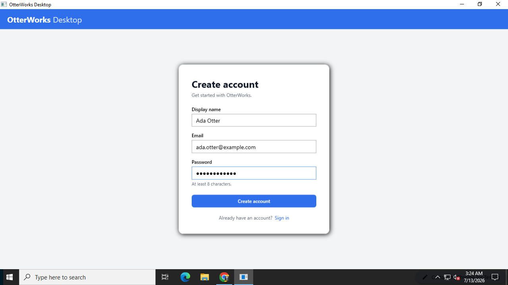
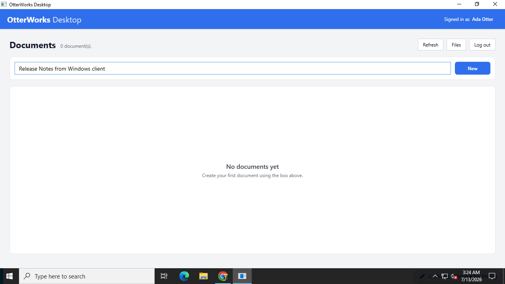
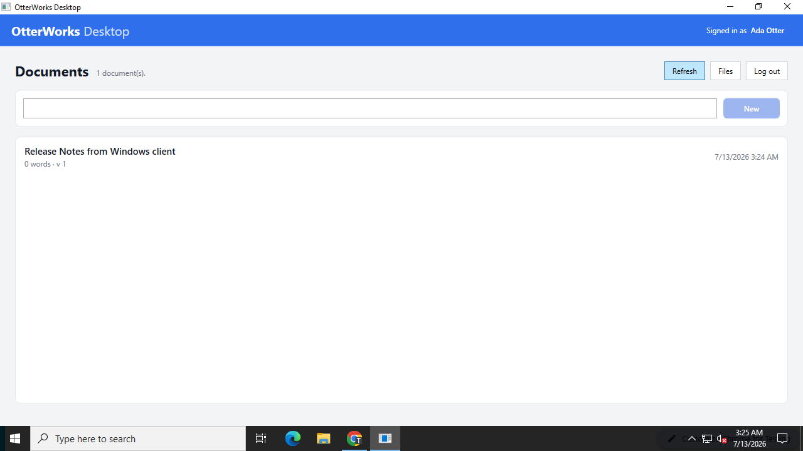
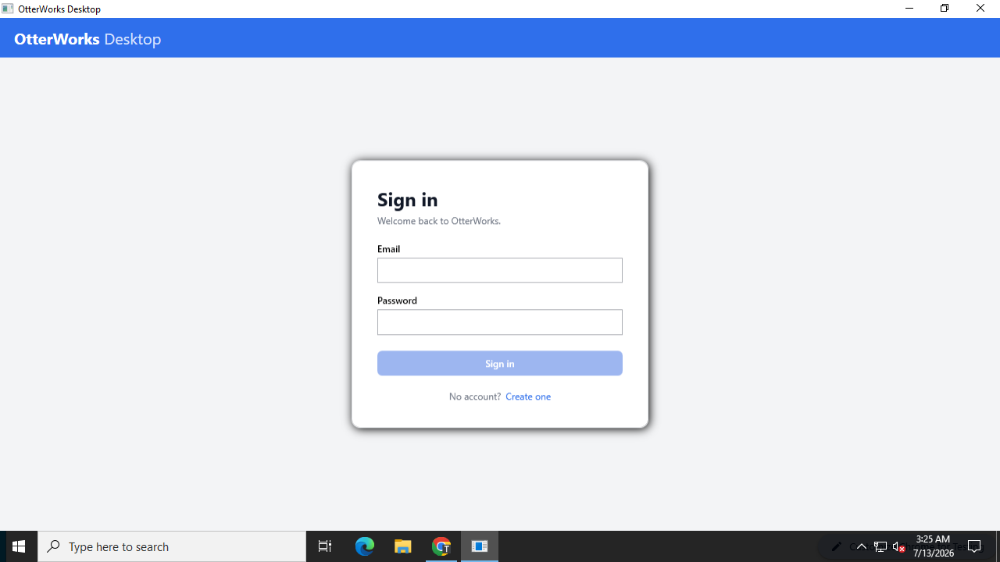
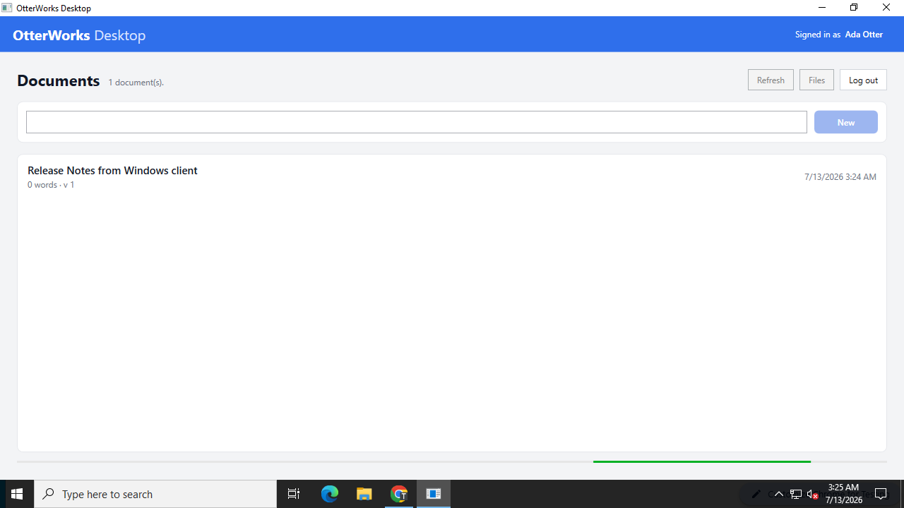

# OtterWorks Desktop (Windows)

A native **Windows desktop client** for the OtterWorks platform, built with **C# on .NET 8**
(`net8.0-windows`) using **WPF** and the **MVVM** pattern. It talks to the OtterWorks REST API
through the API gateway using `HttpClient`.

> **Upgrade history.** Until this upgrade the client was a classic .NET Framework 4.8 project
> (`packages.config`, `Newtonsoft.Json`, MSBuild-only). It is now an SDK-style project with
> `PackageReference`, `System.Text.Json`, nullable reference types and warnings treated as
> errors. `OtterWorks.Desktop.Tests` holds the characterization tests that were written and
> run against the 4.8 build first and pass unchanged on .NET 8.

## Features

- **Register** — display name, email, password → `POST /auth/register`
- **Login** — email, password → `POST /auth/login`, with a link between the two screens
- **Documents list** — `GET /documents` (Bearer token), with a friendly empty state
- **Create document** — a *New* box → `POST /documents { title }` → list refreshes
- **Files list** — `GET /files` (nice-to-have)
- **Logout** — clears the token and returns to the login screen

The JWT access token is held **in memory**. Optionally it can be persisted between runs,
encrypted with the Windows Data Protection API (**DPAPI**, per-user scope) — see
[Configuration](#configuration). Tokens are never written to disk in plaintext.

## Project layout

```
clients/windows-desktop/
├── OtterWorks.Desktop.sln
├── global.json                       # pins the .NET 8 SDK band
├── README.md
├── docs/screenshots/                 # verification screenshots (embedded below)
└── OtterWorks.Desktop/
    ├── OtterWorks.Desktop.csproj      # SDK-style net8.0-windows WPF project
    ├── appsettings.json               # configurable backend base URL
    ├── App.xaml(.cs)                  # DI-free composition root + navigation templates
    ├── Models/                        # Auth (camelCase) + Document/File (snake_case) DTOs
    ├── Mvvm/                          # ObservableObject, RelayCommand, converters
    ├── Services/                      # AppSettings, SessionState (DPAPI), API client, ApiJson
    ├── ViewModels/                    # Login / Register / Documents / Main (shell)
    └── Views/                         # WPF views for each view model
├── OtterWorks.Desktop.Tests/          # xUnit characterization tests (wire contract, DPAPI, settings)
└── stub/                              # local gateway stand-in for the five routes the client calls
```

## Prerequisites

- **Windows 10/11 or Windows Server 2019/2022**
- **.NET 8 SDK** 8.0.400 or a later 8.0 feature band (see `global.json`); it includes the
  Windows Desktop runtime needed to run WPF apps.
- Visual Studio 2022 17.8+ is optional (open the solution and press F5).

DPAPI comes from the `System.Security.Cryptography.ProtectedData` package, the compatibility
package for the API that was built into .NET Framework.

## Configuration

The backend base URL is read from `OtterWorks.Desktop/appsettings.json` (copied next to the
executable on build):

```json
{
  "apiBaseUrl": "http://localhost:8080/api/v1",
  "persistTokens": false
}
```

- `apiBaseUrl` — the OtterWorks API gateway base. Default `http://localhost:8080/api/v1`
  (the app runs on the same host as the Docker Compose backend). Point this at any reachable
  gateway if the backend runs elsewhere.
- `persistTokens` — when `true`, the session is saved to
  `%APPDATA%\OtterWorks\session.dat`, DPAPI-encrypted for the current user, and restored on
  next launch.

## Running the backend

From the repository root (LocalStack emulates AWS — no cloud needed):

```bash
make infra-up && make up
# or, without make:
docker compose -f docker-compose.infra.yml -f docker-compose.yml up -d --build
```

Verify it is healthy:

```bash
curl http://localhost:8080/health      # -> {"status":"healthy",...}
```

## Build and test

```powershell
# From clients/windows-desktop
dotnet build OtterWorks.Desktop.sln -c Release
dotnet test OtterWorks.Desktop.sln -c Release
```

## Run

```powershell
.\OtterWorks.Desktop\bin\Release\net8.0-windows\OtterWorks.Desktop.exe
```

## Running without the backend

`stub/gateway_stub.py` (Python 3, standard library only) answers the five routes the client
calls with in-memory state, in the same camelCase / snake_case shapes:

```powershell
python stub\gateway_stub.py --port 8080 --log requests.jsonl
```

`--log` writes one JSON line per request (passwords redacted); `stub/compare_logs.py
before.jsonl after.jsonl` compares two scripted UI runs request by request.

## End-to-end flow

1. **Register** a new user (display name, email, password ≥ 8 chars).
2. You land on the **Documents** list — empty for a new account.
3. Type a title and click **New** — the document appears in the list.
4. Click **Log out**, then **Sign in** with the same credentials — the document is still
   there, proving it was persisted by the real backend.

## Verification screenshots

Captured on Windows against the OtterWorks backend (auth-service, document-service and
api-gateway) running locally, base URL `http://localhost:8080/api/v1`.

### 1. Register a new user


### 2. Documents list — empty for a new account


### 3. Create a document — it appears in the list


### 4. Log out


### 5. Log back in — the document persists


## API contract used

Base URL: `http://localhost:8080/api/v1`. All non-auth calls send `Authorization: Bearer
<accessToken>`.

| Method & path        | Request                                             | Response (shape)                                        |
|----------------------|-----------------------------------------------------|---------------------------------------------------------|
| `POST /auth/register`| `{ displayName, email, password }`                  | `{ accessToken, refreshToken, tokenType, expiresIn, user }` (camelCase) |
| `POST /auth/login`   | `{ email, password }`                               | same as register                                        |
| `GET /documents`     | query `page`, `size`                                | `{ items:[…], total, page, size, pages }` (snake_case)  |
| `POST /documents`    | `{ title }`                                         | created document object (snake_case)                    |
| `GET /files`         | query `page`, `page_size`                           | `{ files:[…], total, page, page_size }` (snake_case)    |

Auth payloads are camelCase while document/file payloads are snake_case; each model carries
explicit `[JsonPropertyName]` attributes so one set of `System.Text.Json` options
(`Services/ApiJson.cs`) handles both.
