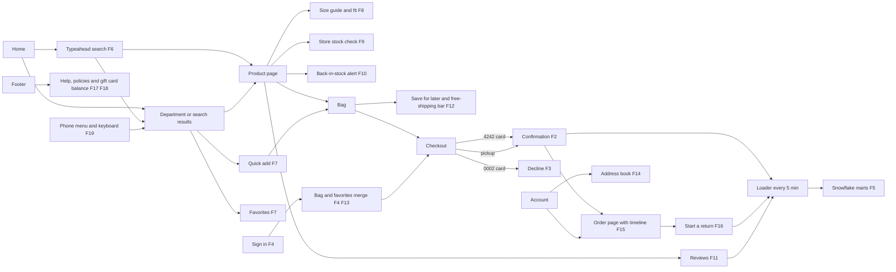

# OtterShops user flows

Every flow below runs against the local Compose stack (`docker-compose.ottershops.yml`, storefront on http://localhost:3000). F1 to F5 are the core slice; F6 onward came with phase 2. The demo shopper is `maya@ottershops.test` / `otters-2026`, and the test cards are `4242 4242 4242 4242` (approves), `4000 0000 0000 0002` (declines) and any number that fails the Luhn check (rejected).

## F1 Browse

1. Open the home page.
2. Hover **Women** and pick a category from the menu, or click **Women**.
3. Filter by size M and color Black, then sort by price, low to high.
4. Click **Load more** at the bottom of the grid.
5. Open a product.

Expected: the hero and countdown show while Black Friday is on; filters and sort update the grid and the item count; more products append under the first page; the product page shows sale and list prices, colors, sizes and stock hints.

## F2 Guest purchase

1. On a product page pick a color and an in-stock size, then **Add to Bag**.
2. In the mini-bag click **View bag**, then apply `BLACKFRIDAY`.
3. Check out as a guest, shipping to San Francisco, CA, with the 4242 card.
4. Open **Track an order** from the footer with the order number and email.

Expected: the code takes an extra 15% off eligible lines; the confirmation shows an `OS-1xxxxx` number and totals that match the bag; the bag empties; order lookup opens the same order.

## F3 Declined payment

1. Bag an item and check out with `4000 0000 0000 0002`.
2. Try again with a card number that fails the Luhn check.

Expected: the 0002 card shows "card was declined" (HTTP 402) and the bad number is rejected before payment (HTTP 400). No order is created and stock does not move.

## F4 Signed-in pickup and rewards

1. As a guest, bag an item.
2. Sign in as the demo shopper.
3. At checkout choose **Pick up in store**, search `94103` and pick a store with pickup on.
4. Pay with the 4242 card.
5. Open **Account**.

Expected: the guest bag merges into the member bag; a California store adds the $0.10 bag fee; the order appears in order history and rewards points rise by the whole-dollar total.

## F5 Snowflake data

1. Wait for the loader (every 5 minutes) or run it once with `python loader/loader.py --once`.
2. In Snowflake run `select order_number, fulfillment, total, created_at from OTTERSHOPS.MARTS.FCT_ORDERS order by created_at desc limit 10;`
3. Run `select * from OTTERSHOPS.MARTS.FCT_RETURNS order by requested_at desc;` and `select * from OTTERSHOPS.MARTS.PRODUCT_ENGAGEMENT where written_reviews > 0 or favorites > 0 or units_returned > 0;`

Expected: the orders placed in F2, F4 and F16 appear in `FCT_ORDERS` within 10 minutes; returns, reviews and favorites made in later flows show in `FCT_RETURNS` and `PRODUCT_ENGAGEMENT` after the next load; `dbt build` passes.

## F6 Search with typeahead

1. Type `denim` in the header search box.
2. Move through the suggestions with the arrow keys, then press Escape.
3. Type `denim` again and choose **See all**.
4. Search for `zzqxv`.

Expected: after two characters a list opens with matching categories, collections and up to six products with prices; the arrow keys move the highlight and Escape closes the list; the results page shows matching products with filters; the nonsense search shows the no-results page with popular searches.

## F7 Quick add and guest favorites

1. On a department grid click the heart on a product card.
2. Click **Quick add** on a card and choose a size.
3. Open **Favorites** in the header.

Expected: the heart fills and the header count rises; quick add puts the item in the bag without leaving the grid; the favorites page lists the saved product and says favorites are kept on this device until you sign in.

## F8 Size guide, fit and outfit ideas

1. On a product page click **Size guide**.
2. Close it with Escape.
3. Scroll to **Complete the look**, **You may also like** and **Recently viewed**.

Expected: the dialog shows the size chart for the product's department and keeps keyboard focus inside until closed; the reviews section shows a fit verdict such as "True to size"; the outfit row shows curated pairings; recently viewed lists products opened earlier in the session.

## F9 Store stock check

1. Pick a size, then click **Check stores**.
2. Search for `CO` or a ZIP code.

Expected: each store shows In stock, Limited or Unavailable for that size, its hours and how soon pickup is ready; stores with pickup off say so.

## F10 Back-in-stock alert

1. Open a product with a sold-out size and click that size.
2. Enter an email and click **Notify me**.

Expected: **Add to Bag** is replaced by the alert form; after submitting, the page confirms the email and size. An alert for a size that is in stock is refused (HTTP 409).

## F11 Reviews

1. Open **Reviews** on a product page.
2. Change the sort to **Most recent**, then click the 5-star bar in the histogram.
3. Click **Write a review**, give 5 stars, a title, a review, a fit and a display name, then post.
4. Click **Helpful** on a review.

Expected: the histogram, average and fit summary match the review list; the star filter narrows the list and the count; the new review appears at once and the product's rating updates; the helpful count rises by one and a second vote from the same browser is refused.

## F12 Bag progress and save for later

1. Open the bag with one item under $50.
2. Click **Save for later** on the line, then **Move to bag**.

Expected: the bar says how much more is needed for free shipping and fills as the subtotal grows; a saved line leaves the total and the header count and returns when moved back.

## F13 Favorites carry over at sign-in

1. As a guest, favorite a product.
2. Sign in as the demo shopper and open **Favorites**.

Expected: the guest favorite now belongs to the member list, and the note reads "Saved to your account".

## F14 Address book

1. Signed in, open **Account** and click **Add an address**.
2. Save an address in Denver, CO, then **Make default** and **Delete** it.

Expected: an unknown state or bad ZIP shows an error; the saved address appears, the default badge moves and the card disappears on delete.

## F15 Order tracking

1. Open an order from **Account** or **Track an order**.

Expected: a timeline shows Placed, Processing, Shipped, Out for delivery and Delivered (or Ready for pickup and Picked up), with times for the steps reached, the carrier, a tracking number and the estimated arrival.

## F16 Start a return

1. On the order page click **Start a return**.
2. Tick a line, choose a reason, pick mail or **Drop off at any store**, then submit.

Expected: a return number and a refund amount (merchandise plus its share of tax) appear on the order; the same line cannot be returned twice; final-sale gift cards are not offered for return; orders older than 45 days have no return button.

## F17 Gift card balance

1. Open **Gift cards** from the footer.
2. Check `6006 4912 3456 7890` with PIN `1234`, then try PIN `9999`.

Expected: the first check shows $50.00 left on the card ending 7890; the wrong PIN shows a message that does not say whether the number exists.

## F18 Help and policy pages

1. From the footer open **Help center**, **Shipping**, **Returns**, **Size guide**, **Contact us**, **Accessibility**, **Privacy** and **Terms of use**.

Expected: every link opens a page with real content and no broken links.

## F19 Phone menu and keyboard use

1. Narrow the window to phone width (390 px) and reload.
2. Press Tab once.
3. Open the menu, press Escape, open it again, expand **Men** and choose **Shop all**.

Expected: the first Tab shows **Skip to content**; the menu slides in, locks page scroll and closes on Escape with focus back on the menu button; department links work from the drawer.
