# Claims hub move: digest for claims operations

The claims hub that takes agency first notices of loss, pays vendors and assigns adjusters is being moved off BizTalk Server onto a Java service (`claims-hub-camel`). The full row-by-row evidence is in [`CUTOVER_RECONCILIATION.md`](CUTOVER_RECONCILIATION.md). Nothing has been switched over; all of the work below is in open pull requests.

## What moved

- **All 8 transformations** that turn one document into another (FNOL to claim, claim to policy lookup, claim to claims-system insert, triage facts, ledger post, vendor remittance, roster lookup, adjuster notice).
- **The 3 processes**: FNOL intake (with the 15 minute correction window), claim payment (ledger post first, vendor file second, reversal and an ops mail if the vendor cannot be reached after 3 tries), and adjuster assignment (least-loaded eligible adjuster, supervisor escalation, archive copy).
- **The 7 triage rules** (decline, three fraud rules, fast track, large loss, standard), now a table that can be read and changed without code.
- **The three automatic copies**: fraud desk referrals, declines to the agency liaison folder, glass fast tracks to the glass partner.

## The number

**40 of 40 test messages come out byte-identical to BizTalk** (16 FNOL, 14 payments, 10 assignments). The nightly comparison, which checks every document the 40 messages produce, reads **142 of 142 identical**. No message differs.

What the rest are: **1 of the 40 is still red although its documents are identical.** On payment PI-2026-880107 the ledger posts **1,235.08** and the vendor file pays **1,235.09**. BizTalk does exactly the same today: the ledger rounds the total once, the vendor file rounds each line, and two lines carry fractions of a cent (0.015 and 1,234.565). The new hub copies this faithfully, and the check that ledger and file agree to the cent fails on that one payment. The nightly gate therefore shows one red test, and will keep doing so until claims finance decides.

Besides that, 18 differences are by design and do not change any document: on declined FNOLs the new hub records the reason ("policy not in force at loss date") next to TERMINATED, and payment files show DELIVERED with the vendor's dated file name, where the BizTalk test files only show ASSEMBLED.

## What it means for the night batch

- **The cent.** Any night an instruction has sub-cent lines, ledger and vendor can be a cent apart, exactly as now. The move neither creates nor fixes this. In the 14 test payments it happens once.
- **Not ready for a real night yet.** The new hub cannot yet collect the agencies' nightly SFTP batches, split a batch into claims, or mask tax ids on the way in. It also does not survive a restart in the middle of the night: a pending FNOL correction, or a payment waiting for the vendor window, would be lost. Today it runs from test drops and stand-in databases.
- **Held payments.** If the vendor is unreachable, the post is reversed and operations is mailed, as today, but the held payment cannot be released again through the new hub yet.

## The screens, before and after

The same corpus messages shown once from the BizTalk results (left) and once from the new hub (right). Screens from [#2129](https://github.com/Cognition-Partner-Workshops/otterworks/pull/2129).

| Before: BizTalk | After: new hub |
| --- | --- |
| 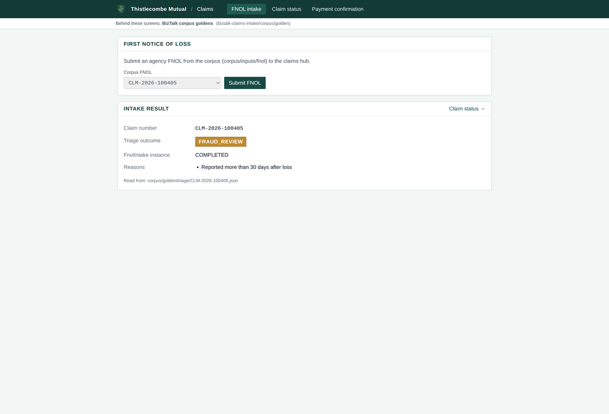 | 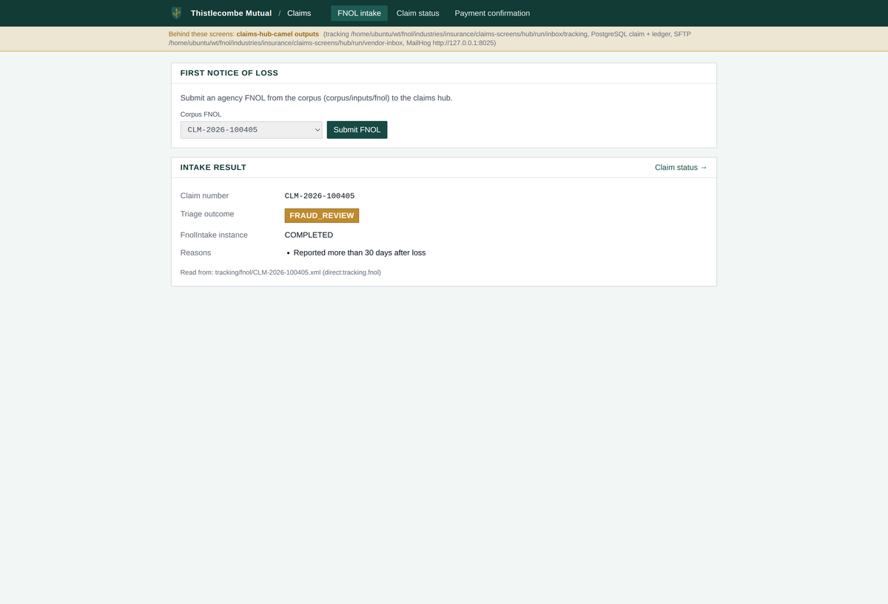 |
| FNOL CLM-2026-100405: FRAUD_REVIEW, COMPLETED, "Reported more than 30 days after loss" | Same outcome, same reason |
| 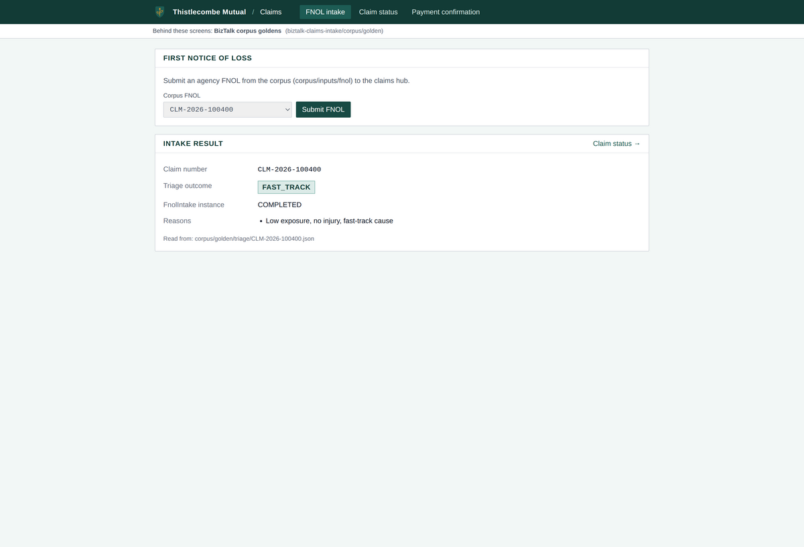 | 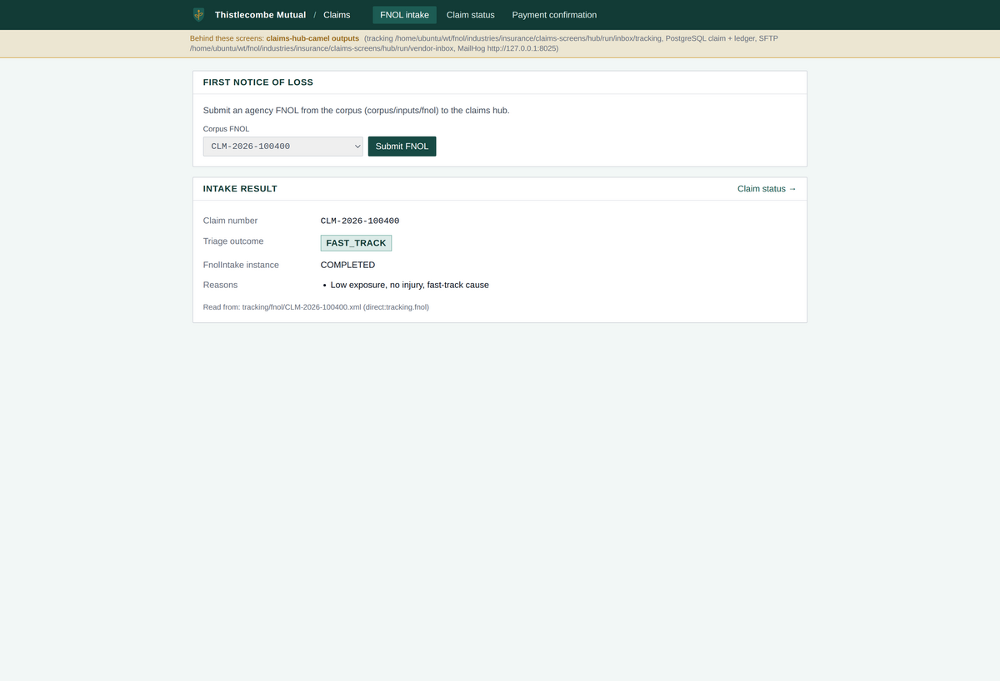 |
| FNOL CLM-2026-100400: FAST_TRACK, COMPLETED, "Low exposure, no injury, fast-track cause" | Same outcome, same reason |
| 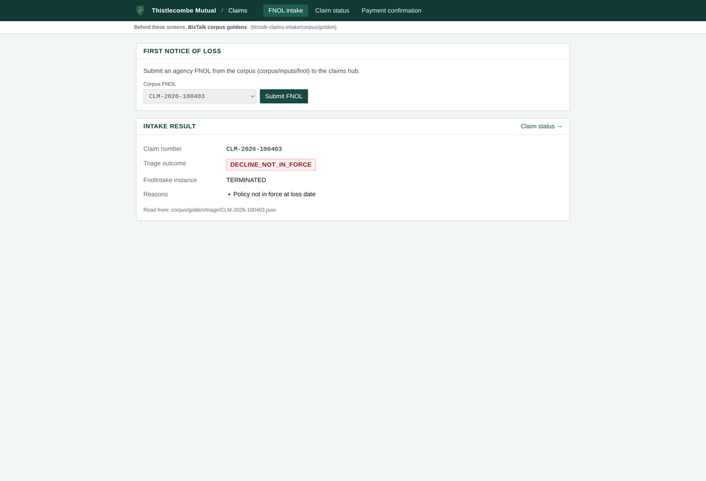 | 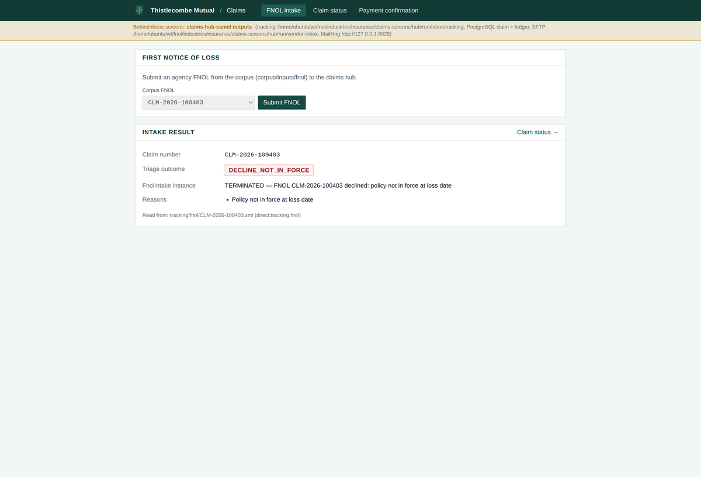 |
| FNOL CLM-2026-100403: DECLINE_NOT_IN_FORCE, TERMINATED | DECLINE_NOT_IN_FORCE, TERMINATED with the reason "declined: policy not in force at loss date" |
| 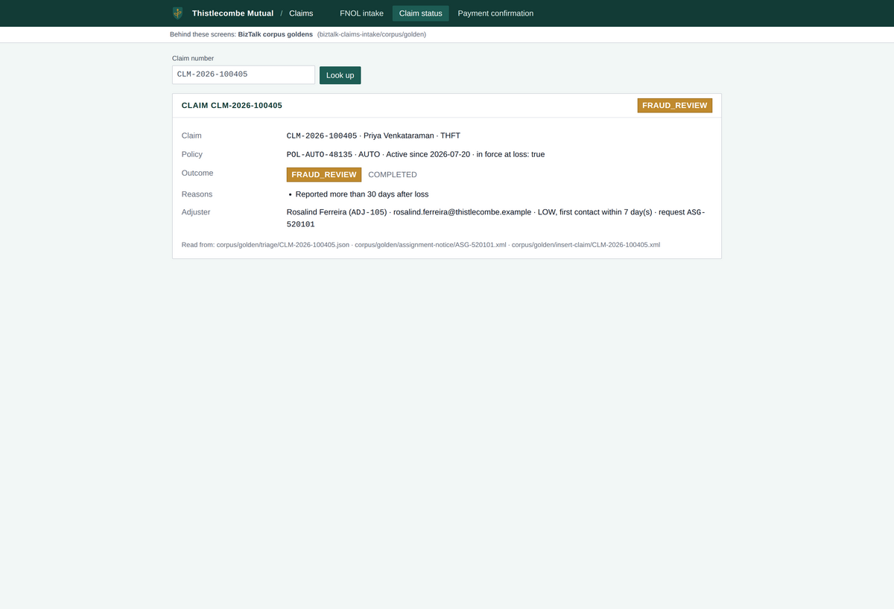 | 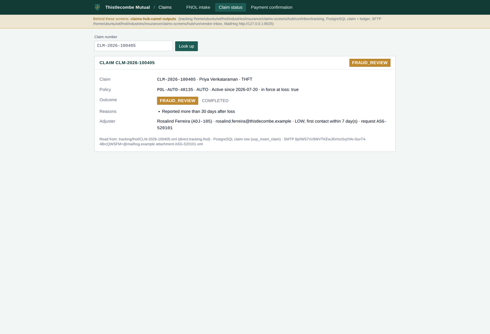 |
| Claim CLM-2026-100405: FRAUD_REVIEW, policy POL-AUTO-48135 in force, adjuster Rosalind Ferreira (ADJ-105), 7 day first contact | Same claim, policy and adjuster |
| 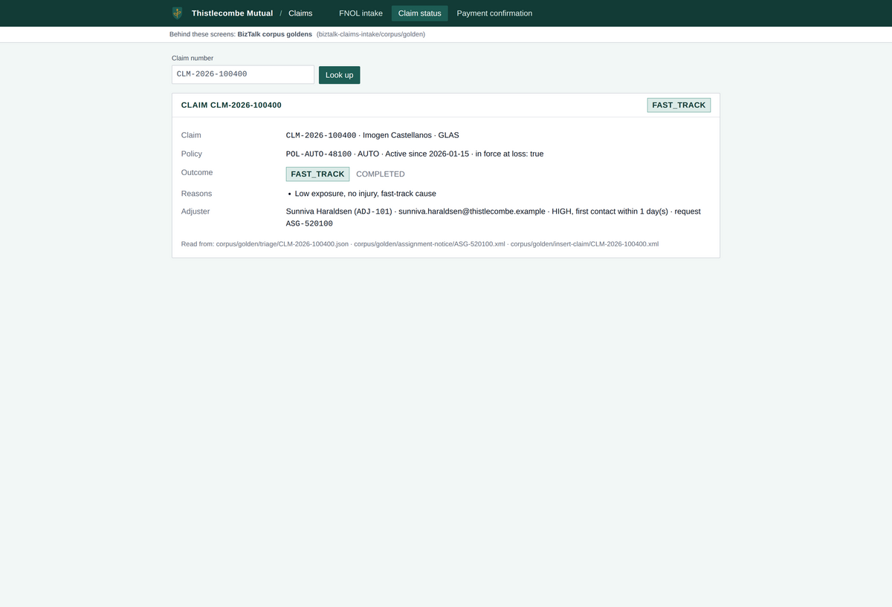 | 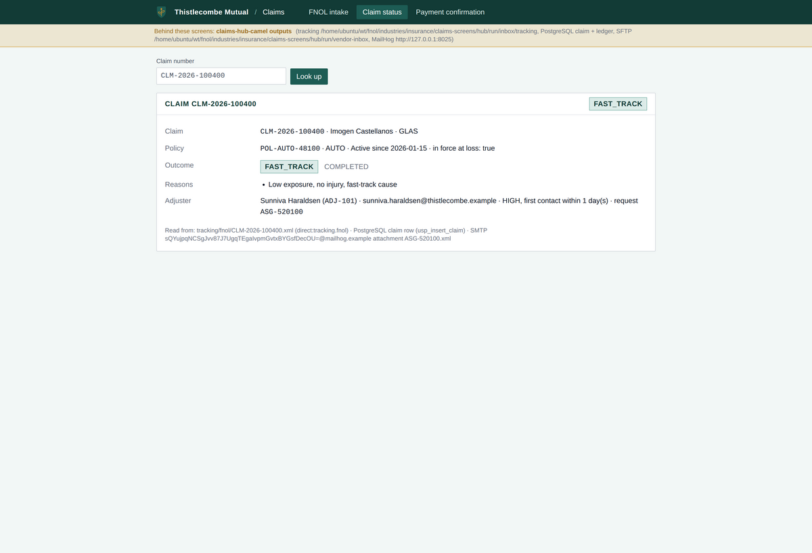 |
| Claim CLM-2026-100400: FAST_TRACK, policy POL-AUTO-48100, adjuster Sunniva Haraldsen (ADJ-101) | Same claim, policy and adjuster |
| 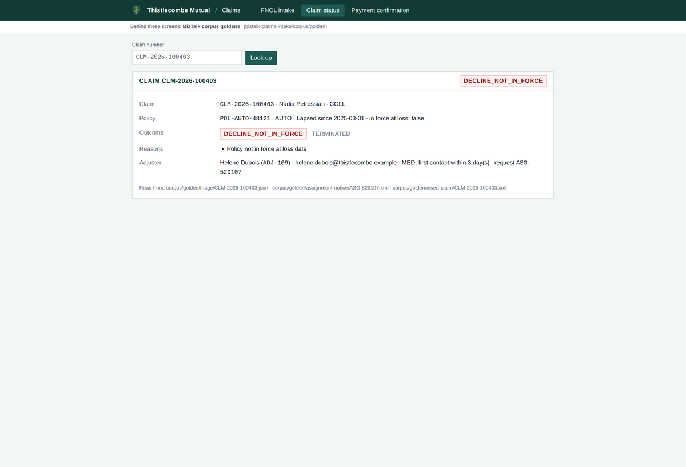 | 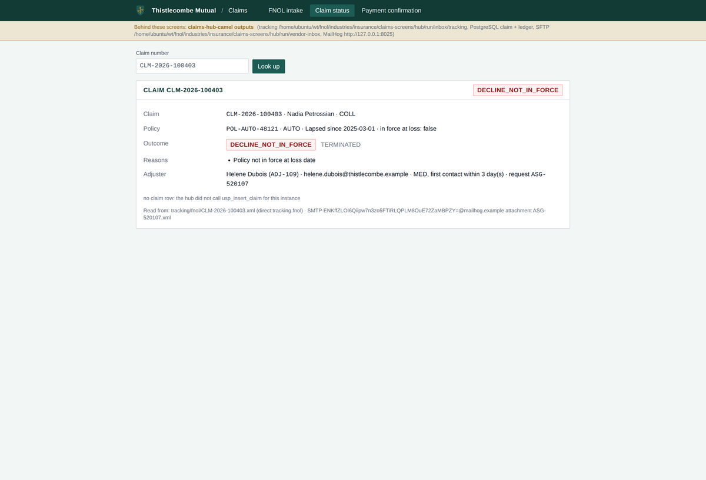 |
| Claim CLM-2026-100403: DECLINE_NOT_IN_FORCE, policy lapsed since 2025-03-01, adjuster Helene Dubois (ADJ-109) | Same, plus "no claim row": a declined claim is never inserted, as in BizTalk |
| 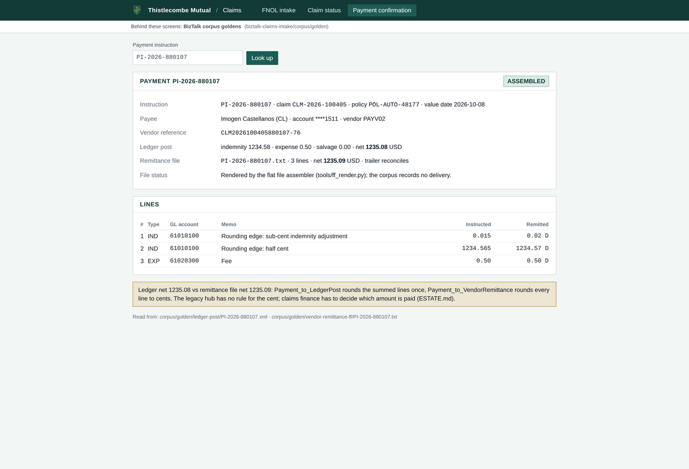 | 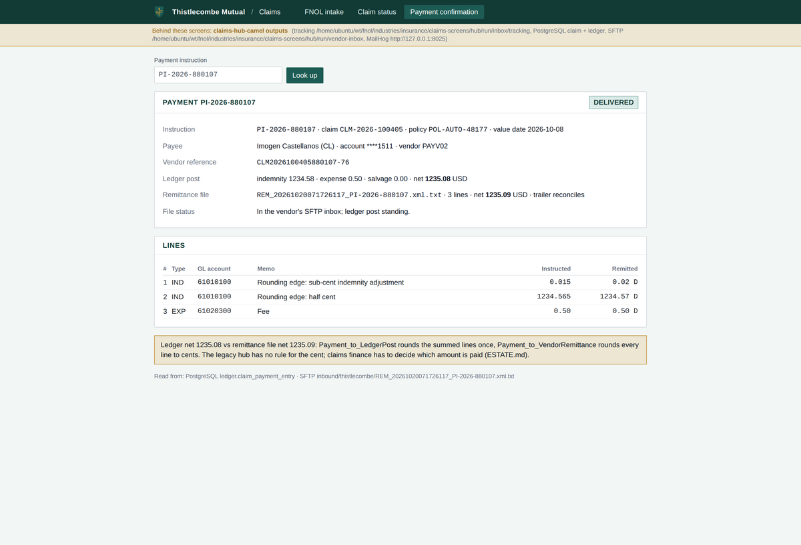 |
| Payment PI-2026-880107: ASSEMBLED, ledger net **1,235.08**, file net **1,235.09** | DELIVERED to the vendor inbox, ledger net **1,235.08**, file net **1,235.09**: the same cent |

## Decision for claims finance: which amount is paid on PI-2026-880107

1. **The ledger follows the vendor file**: post the sum of the rounded lines (1,235.09), so the ledger matches the cash that leaves. *Recommended.*
2. The file follows the ledger: round once and put the cent difference on the last line (1,235.08).
3. Keep both as BizTalk does and reconcile the cent by hand. This is what the new hub does until finance answers.

## Cutover options

| | Option A: one flow at a time | Option B: everything on one night |
| --- | --- | --- |
| How | Assignment first, then FNOL, then payment last; BizTalk keeps running the flows that have not moved | All three flows switch on one night once every open item is closed |
| Before it can start | Assignment needs the claims-system polling; FNOL needs the agency SFTP batch, splitting and masking; payment needs finance's answer, restart safety and held-payment release | All of the items on the left |
| Fallback | Per flow, back to BizTalk | Whole hub back to BizTalk |
| Exposure | One flow's night batch at a time | Every night batch at once |

**Recommendation: Option A,** with payment last, after finance has answered and the nightly comparison has run fully green (no red test) on consecutive nights. Neither option can start tonight.

## Not done yet

- Finance answer on the PI-2026-880107 cent, and how a released held payment shows in the ledger.
- Agency SFTP collection, batch splitting and tax id masking for FNOL; claims-system polling for assignments.
- Restart safety for the FNOL correction window and the payment-in-flight.
- Connection to the real claims system, policy admin, roster and file shares (today: stand-ins); the glass partner's SFTP; the vendor's acknowledgement.
- Two readings of the old solution to confirm with its owner (how the correction window and the rules engine really behave in production), and one question for claims operations: do the fraud desk and agency liaison folders receive files today?
- None of the work is merged; it is in review.
