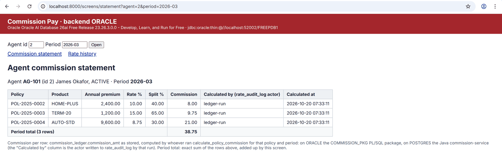
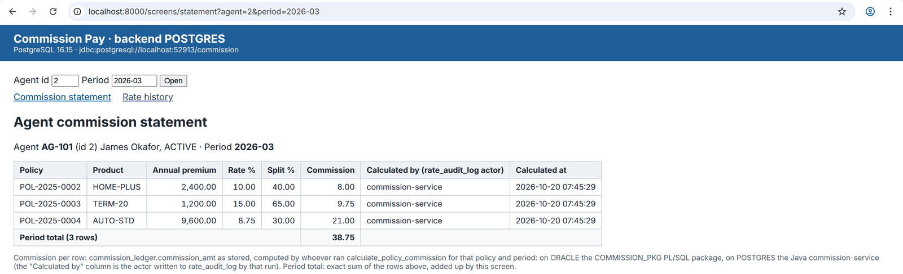
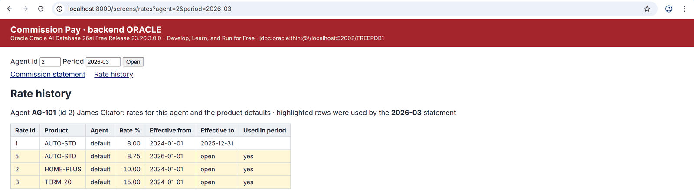
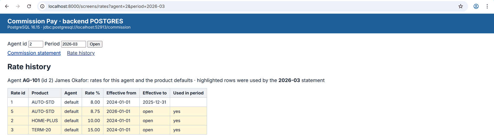

# Commission Pay cutover: one-page digest for finance

**Where we are.** The commission rules are moving out of the Oracle database into a separate Java service, and the data is moving from Oracle to PostgreSQL 16. All of this is on open change requests. Nothing has merged, and Oracle is still the system of record. Detail and links are in [CUTOVER_RECONCILIATION.md](CUTOVER_RECONCILIATION.md).

**What moved, and whether it matches**
- All Commission Pay tables were copied to PostgreSQL 16: 13 tables, 382 rows, every row identical ([#2097](https://github.com/Cognition-Partner-Workshops/otterworks/pull/2097)).
- The rate, split and commission-calculation rules now run in the Java service, behind the same Oracle entry points ([#2123](https://github.com/Cognition-Partner-Workshops/otterworks/pull/2123), [#2122](https://github.com/Cognition-Partner-Workshops/otterworks/pull/2122), [#2124](https://github.com/Cognition-Partner-Workshops/otterworks/pull/2124)). Every commission amount the tests check matches Oracle to the cent. **Red:** in 10 of 104 tests, when a database rule rejects an entry (missing user name, out-of-range value, bad month), the error comes back under a different error code. No money is involved. The nightly check shows the same red on three rules ([#2131](https://github.com/Cognition-Partner-Workshops/otterworks/issues/2131)). The system owners have to choose how errors are reported.
- The statement and rate-history screens give the same figures on both systems ([#2130](https://github.com/Cognition-Partner-Workshops/otterworks/pull/2130)).

**The number: monthly ledger total per agent against the warehouse rollup**

| Agent, month | Ledger, Oracle (old) | Rollup, Oracle (old) | Ledger, PostgreSQL (new) | Rollup, PostgreSQL (new) | Difference |
|---|---:|---:|---:|---:|---:|
| AG-101, 2025-06 | 36.95 | 36.95 | 36.95 | 36.95 | 0.00 |
| AG-101, 2026-03 | 38.75 | 38.75 | 38.75 | 38.75 | 0.00 |
| All agents, Feb 2025 to Mar 2026 | 1,418.50 | 1,418.50 | 1,418.50 | 1,418.50 | 0.00 |

Who computed it: on the old side, Oracle's own calculation. On the new side, the 2026-03 ledger was recalculated by the Java service on PostgreSQL. Every other month, 2025-06 included, is still Oracle's figure copied across. Each rollup is the reporting summary on its own database. The new 2026-03 rollup was measured before the Java recalculation, which reproduced the same 38.75. The new warehouse tool (dbt) does not produce a rollup yet.

**Screens: agent AG-101, before (Oracle) on the left, after (Java service on PostgreSQL 16) on the right**

The screens in [#2130](https://github.com/Cognition-Partner-Workshops/otterworks/pull/2130) were captured for **2026-03**, not 2025-06. 2026-03 is the only month the Java service has recalculated so far, and no 2025-06 screens exist. The 2025-06 figures are in the table above.

| Before: Oracle | After: Java service on PostgreSQL 16 |
|---|---|
|  |  |
| POL-2025-0002 **8.00**, POL-2025-0003 **9.75**, POL-2025-0004 **21.00**; total **38.75**. Rows computed by Oracle's commission package (shown as "ledger-run"); the screen adds up the total. | POL-2025-0002 **8.00**, POL-2025-0003 **9.75**, POL-2025-0004 **21.00**; total **38.75**. Rows computed by the Java service (shown as "commission-service"); the screen adds up the total. |
|  |  |
| 4 rates: AUTO-STD 8.00 (closed 2025-12-31) and 8.75, HOME-PLUS 10.00, TERM-20 15.00. Stored rates; nothing is computed. | The same 4 rates, copied from Oracle. Stored rates; nothing is computed. |

**The divergence found: half-cent rounding (decision D4, [#2097](https://github.com/Cognition-Partner-Workshops/otterworks/pull/2097))**

Commission is premium ÷ 12 × rate × split, rounded to the cent. When the exact amount is a half cent, Oracle sometimes rounds it down. For example, an exact 50.015 is booked as 50.01.

- **Option A: keep Oracle's rounding.** In a test of 1,600,080 premium/rate/split combinations, every amount came out the same as Oracle. This is what the PostgreSQL side uses today.
- **Option B: exact half-up rounding.** 107 of the 1,600,080 amounts are one cent higher than Oracle. If a month that has already been paid is re-run, a booked amount can change by 0.01.

**Recommendation: A for the cutover.** If finance wants B, treat it as a separate, dated policy change with its own cutover entry. **We need your decision.** Earlier decisions D-1 to D-3 are also still open: split percentages with more than two decimals, the penny difference when a policy's split rows are added up, and same-day rate corrections ([#2087](https://github.com/Cognition-Partner-Workshops/otterworks/pull/2087)).

**Not done yet**
- The new warehouse (dbt) has no models yet. Its month-end comparison with Oracle's pinned 2025 figures (2,328.31 for the year; AG-101 June 70.95) has not been run ([#2115](https://github.com/Cognition-Partner-Workshops/otterworks/pull/2115), [#2132](https://github.com/Cognition-Partner-Workshops/otterworks/pull/2132)).
- The Java service has recalculated only 2026-03. It has not yet been run through the 1.6M rounding test.
- The error-code decision is still open, and two of the rule groups are not yet in the nightly check.
- Nothing has merged. Oracle has not been switched off.
