# BW6 dependency graph

Generated from source by `tools/build_graph.py`, run **tib-d1111**. Evidence uses repo-root `path:L<n>` citations with links to the cited source lines.

The graph records configured dependencies, not verified runtime bindings. Starter destination fields on SFTPGet, Timer and internal.start are retained as `consumes` edges but are not evidence of actual JMS receivers. Undeclared destination types remain null unless implied by the JMS activity type.

```mermaid
flowchart LR
  subgraph domain0["account-events"]
    n0["account-events.account-closed"]
    n1["account-events.account-opened"]
    n2["account-events.address-changed"]
    n3["account-events.event-fanout"]
    n4["account-events.limit-changed"]
  end
  subgraph domain1["customer-alerts"]
    n5["customer-alerts.card-dispute"]
    n6["customer-alerts.large-transaction"]
    n7["customer-alerts.low-balance"]
    n8["customer-alerts.preference-sync"]
  end
  subgraph domain2["fees-billing"]
    n9["fees-billing.daily-fee"]
    n10["fees-billing.fee-posting"]
    n11["fees-billing.fee-reversal"]
    n12["fees-billing.month-end-summary"]
  end
  subgraph domain3["payments"]
    n13["payments.currency-routing"]
    n14["payments.instruction-intake"]
    n15["payments.payment-returns"]
    n16["payments.sanctions-screening"]
    n17["payments.status-update"]
    n18["payments.validation-enrichment"]
  end
  subgraph domain4["statements-documents"]
    n19["statements-documents.delivery-notice"]
    n20["statements-documents.document-store"]
    n21["statements-documents.pdf-request"]
    n22["statements-documents.split-enrich"]
    n23["statements-documents.statement-drop"]
  end
  n24["${billing.url}"]
  n25["${files.url}"]
  n26["${notifications.url}"]
  n27["${screening.url} (dev v1 / prod v2)"]
  n28["HB.ACCOUNT.ARCHIVED"]
  n29["HB.ACCOUNT.CLOSED"]
  n30["HB.ACCOUNT.CREATED"]
  n31["HB.ACCOUNT.EVENTS"]
  n32["HB.ACCOUNT.EVENTS.IN"]
  n33["HB.ACCOUNT.OPENED"]
  n34["HB.ADDRESS.CHANGED"]
  n35["HB.ADDRESS.UPDATED"]
  n36["HB.ALERT.PREFERENCES"]
  n37["HB.ALERTS.CARD.DISPUTE"]
  n38["HB.ALERTS.LARGE.TRANSACTION"]
  n39["HB.ALERTS.LOW.BALANCE"]
  n40["HB.CURRENCY.ROUTED"]
  n41["HB.CURRENCY.ROUTING"]
  n42["HB.DAILY.FEES (starter field; not JMS receiver)"]
  n43["HB.DELIVERY.CONFIRMED"]
  n44["HB.DELIVERY.NOTICE"]
  n45["HB.DISPUTE.RECEIVED"]
  n46["HB.DOCUMENT.STORE"]
  n47["HB.DOCUMENT.STORED"]
  n48["HB.FEE.CALCULATED"]
  n49["HB.FEE.POSTED"]
  n50["HB.FEE.POSTING"]
  n51["HB.FEE.REVERSAL"]
  n52["HB.FEE.REVERSED"]
  n53["HB.FEE.SUMMARY"]
  n54["HB.LARGE.TRANSACTION.ALERTED"]
  n55["HB.LIMIT.CHANGED"]
  n56["HB.LIMIT.UPDATED"]
  n57["HB.LOW.BALANCE.ALERTED"]
  n58["HB.MONTH.END.SUMMARY (starter field; not JMS receiver)"]
  n59["HB.PAYMENT.ENRICHED"]
  n60["HB.PAYMENT.INSTRUCTIONS"]
  n61["HB.PAYMENT.RETURNS"]
  n62["HB.PAYMENT.STATUS"]
  n63["HB.PAYMENT.VALIDATION"]
  n64["HB.PDF.REQUEST"]
  n65["HB.PDF.REQUESTED"]
  n66["HB.PREFERENCES.SYNCED"]
  n67["HB.RETURN.POSTED"]
  n68["HB.SANCTIONS.REQUEST"]
  n69["HB.SANCTIONS.RESPONSE"]
  n70["HB.STATEMENT.DROP (starter field; not JMS receiver)"]
  n71["HB.STATEMENT.ENRICHED"]
  n72["HB.STATEMENT.READY"]
  n73["HB.STATEMENT.SPLIT"]
  n74["HB.STATUS.PUBLISHED"]
  n75["HB.STATUS.UPDATE"]
  n81["/upload/in"]
  n82["/upload/out/statements-documents.split-enrich"]
  n83["/upload/out/statements-documents.statement-drop"]
  n29 -->|"consumes"| n0
  n0 -->|"produces"| n28
  n33 -->|"consumes"| n1
  n1 -->|"produces"| n30
  n34 -->|"consumes"| n2
  n2 -->|"produces"| n35
  n32 -->|"consumes"| n3
  n3 -->|"produces"| n31
  n3 -. "call (name mismatch)" .-> n1
  n3 -. "call (name mismatch)" .-> n2
  n3 -. "call (name mismatch)" .-> n4
  n3 -. "call (name mismatch)" .-> n0
  n55 -->|"consumes"| n4
  n4 -->|"produces"| n56
  n37 -->|"consumes"| n5
  n5 -->|"produces"| n45
  n38 -->|"consumes"| n6
  n6 -->|"produces"| n54
  n39 -->|"consumes"| n7
  n7 -->|"produces"| n57
  n36 -->|"consumes"| n8
  n8 -->|"http_post"| n26
  n8 -->|"produces"| n66
  n42 -->|"consumes"| n9
  n9 -->|"produces"| n48
  n50 -->|"consumes"| n10
  n10 -->|"http_post"| n24
  n10 -->|"produces"| n49
  n51 -->|"consumes"| n11
  n11 -->|"produces"| n52
  n58 -->|"consumes"| n12
  n12 -->|"produces"| n53
  n41 -->|"consumes"| n13
  n13 -->|"produces"| n40
  n60 -->|"consumes"| n14
  n14 -->|"produces"| n62
  n14 -. "call (name mismatch)" .-> n18
  n14 -. "call (name mismatch)" .-> n16
  n14 -. "call (name mismatch)" .-> n13
  n14 -. "call (name mismatch)" .-> n17
  n61 -->|"consumes"| n15
  n15 -->|"produces"| n67
  n68 -->|"consumes"| n16
  n16 -->|"http_post"| n27
  n16 -->|"produces"| n69
  n75 -->|"consumes"| n17
  n17 -->|"produces"| n74
  n63 -->|"consumes"| n18
  n18 -->|"produces"| n59
  n44 -->|"consumes"| n19
  n19 -->|"produces"| n43
  n46 -->|"consumes"| n20
  n20 -->|"http_post"| n25
  n20 -->|"produces"| n47
  n64 -->|"consumes"| n21
  n21 -->|"http_post"| n27
  n21 -->|"produces"| n65
  n73 -->|"consumes"| n22
  n22 -->|"sftp_put"| n82
  n22 -->|"produces"| n71
  n70 -->|"consumes"| n23
  n23 -->|"sftp_get"| n81
  n23 -->|"sftp_put"| n83
  n23 -->|"produces"| n72
  n23 -. "call (name mismatch)" .-> n22
  n23 -. "call (name mismatch)" .-> n21
  n23 -. "call (name mismatch)" .-> n20
  n23 -. "call (name mismatch)" .-> n19
  classDef shared fill:#fff2b2,stroke:#a65d00,stroke-width:3px
  class n27 shared
```

The diagram omits HB.UNDLV, shared-resource, table and stylesheet dependencies; the tables below retain them. 24 processes configure a fault to HB.UNDLV and 24 reference EmsConnection. 22 processes reference LedgerJdbc; the two without a LedgerJdbc reference are `payments.currency-routing`, `statements-documents.pdf-request`. Resource edges are per activity, so repeated resource references are retained rather than collapsed.

## Findings

- 12 configured call-process references; 0 cross domain boundaries. All names omit the declared `halvergate.` prefix. These are candidate callee links, not proof of resolved runtime bindings (see decisions).
- `${screening.url}` is shared by payments.sanctions-screening and statements-documents.pdf-request; dev uses v1 and prod uses v2.
- 0 destinations have both an in-project producer and consumer. No output destination connects one process to another.

## Behavioral edges

| From | Kind | To | Evidence link |
| --- | --- | --- | --- |
| `halvergate.account-events.account-closed` | fault_to | `jms:HB.UNDLV` | [`integration/legacy-bw6/Processes/account-events/account-closed.bwp:L7`](../../legacy-bw6/Processes/account-events/account-closed.bwp#L7) |
| `jms:HB.ACCOUNT.CLOSED` | consumes | `halvergate.account-events.account-closed` | [`integration/legacy-bw6/Processes/account-events/account-closed.bwp:L14`](../../legacy-bw6/Processes/account-events/account-closed.bwp#L14) |
| `halvergate.account-events.account-closed` | writes_table (AUTO_COMMIT) | `table:account_closures` | [`integration/legacy-bw6/Processes/account-events/account-closed.bwp:L24`](../../legacy-bw6/Processes/account-events/account-closed.bwp#L24) |
| `halvergate.account-events.account-closed` | produces | `jms:HB.ACCOUNT.ARCHIVED` | [`integration/legacy-bw6/Processes/account-events/account-closed.bwp:L29`](../../legacy-bw6/Processes/account-events/account-closed.bwp#L29) |
| `halvergate.account-events.account-opened` | fault_to | `jms:HB.UNDLV` | [`integration/legacy-bw6/Processes/account-events/account-opened.bwp:L7`](../../legacy-bw6/Processes/account-events/account-opened.bwp#L7) |
| `jms:HB.ACCOUNT.OPENED` | consumes | `halvergate.account-events.account-opened` | [`integration/legacy-bw6/Processes/account-events/account-opened.bwp:L14`](../../legacy-bw6/Processes/account-events/account-opened.bwp#L14) |
| `halvergate.account-events.account-opened` | writes_table (AUTO_COMMIT) | `table:account_registry` | [`integration/legacy-bw6/Processes/account-events/account-opened.bwp:L24`](../../legacy-bw6/Processes/account-events/account-opened.bwp#L24) |
| `halvergate.account-events.account-opened` | produces | `jms:HB.ACCOUNT.CREATED` | [`integration/legacy-bw6/Processes/account-events/account-opened.bwp:L29`](../../legacy-bw6/Processes/account-events/account-opened.bwp#L29) |
| `halvergate.account-events.address-changed` | fault_to | `jms:HB.UNDLV` | [`integration/legacy-bw6/Processes/account-events/address-changed.bwp:L7`](../../legacy-bw6/Processes/account-events/address-changed.bwp#L7) |
| `jms:HB.ADDRESS.CHANGED` | consumes | `halvergate.account-events.address-changed` | [`integration/legacy-bw6/Processes/account-events/address-changed.bwp:L14`](../../legacy-bw6/Processes/account-events/address-changed.bwp#L14) |
| `halvergate.account-events.address-changed` | writes_table (AUTO_COMMIT) | `table:account_addresses` | [`integration/legacy-bw6/Processes/account-events/address-changed.bwp:L24`](../../legacy-bw6/Processes/account-events/address-changed.bwp#L24) |
| `halvergate.account-events.address-changed` | produces | `jms:HB.ADDRESS.UPDATED` | [`integration/legacy-bw6/Processes/account-events/address-changed.bwp:L29`](../../legacy-bw6/Processes/account-events/address-changed.bwp#L29) |
| `halvergate.account-events.event-fanout` | fault_to | `jms:HB.UNDLV` | [`integration/legacy-bw6/Processes/account-events/event-fanout.bwp:L7`](../../legacy-bw6/Processes/account-events/event-fanout.bwp#L7) |
| `jms:HB.ACCOUNT.EVENTS.IN` | consumes | `halvergate.account-events.event-fanout` | [`integration/legacy-bw6/Processes/account-events/event-fanout.bwp:L14`](../../legacy-bw6/Processes/account-events/event-fanout.bwp#L14) |
| `halvergate.account-events.event-fanout` | writes_table (AUTO_COMMIT) | `table:account_events` | [`integration/legacy-bw6/Processes/account-events/event-fanout.bwp:L24`](../../legacy-bw6/Processes/account-events/event-fanout.bwp#L24) |
| `halvergate.account-events.event-fanout` | produces | `jms:HB.ACCOUNT.EVENTS` | [`integration/legacy-bw6/Processes/account-events/event-fanout.bwp:L29`](../../legacy-bw6/Processes/account-events/event-fanout.bwp#L29) |
| `halvergate.account-events.event-fanout` | call_process: binding unresolved (see decisions) | `halvergate.account-events.account-opened` | [`integration/legacy-bw6/Processes/account-events/event-fanout.bwp:L34`](../../legacy-bw6/Processes/account-events/event-fanout.bwp#L34) [`integration/legacy-bw6/Processes/account-events/account-opened.bwp:L2`](../../legacy-bw6/Processes/account-events/account-opened.bwp#L2) |
| `halvergate.account-events.event-fanout` | call_process: binding unresolved (see decisions) | `halvergate.account-events.address-changed` | [`integration/legacy-bw6/Processes/account-events/event-fanout.bwp:L39`](../../legacy-bw6/Processes/account-events/event-fanout.bwp#L39) [`integration/legacy-bw6/Processes/account-events/address-changed.bwp:L2`](../../legacy-bw6/Processes/account-events/address-changed.bwp#L2) |
| `halvergate.account-events.event-fanout` | call_process: binding unresolved (see decisions) | `halvergate.account-events.limit-changed` | [`integration/legacy-bw6/Processes/account-events/event-fanout.bwp:L44`](../../legacy-bw6/Processes/account-events/event-fanout.bwp#L44) [`integration/legacy-bw6/Processes/account-events/limit-changed.bwp:L2`](../../legacy-bw6/Processes/account-events/limit-changed.bwp#L2) |
| `halvergate.account-events.event-fanout` | call_process: binding unresolved (see decisions) | `halvergate.account-events.account-closed` | [`integration/legacy-bw6/Processes/account-events/event-fanout.bwp:L49`](../../legacy-bw6/Processes/account-events/event-fanout.bwp#L49) [`integration/legacy-bw6/Processes/account-events/account-closed.bwp:L2`](../../legacy-bw6/Processes/account-events/account-closed.bwp#L2) |
| `halvergate.account-events.limit-changed` | fault_to | `jms:HB.UNDLV` | [`integration/legacy-bw6/Processes/account-events/limit-changed.bwp:L7`](../../legacy-bw6/Processes/account-events/limit-changed.bwp#L7) |
| `jms:HB.LIMIT.CHANGED` | consumes | `halvergate.account-events.limit-changed` | [`integration/legacy-bw6/Processes/account-events/limit-changed.bwp:L14`](../../legacy-bw6/Processes/account-events/limit-changed.bwp#L14) |
| `halvergate.account-events.limit-changed` | writes_table (AUTO_COMMIT) | `table:account_limits` | [`integration/legacy-bw6/Processes/account-events/limit-changed.bwp:L24`](../../legacy-bw6/Processes/account-events/limit-changed.bwp#L24) |
| `halvergate.account-events.limit-changed` | produces | `jms:HB.LIMIT.UPDATED` | [`integration/legacy-bw6/Processes/account-events/limit-changed.bwp:L29`](../../legacy-bw6/Processes/account-events/limit-changed.bwp#L29) |
| `halvergate.customer-alerts.card-dispute` | fault_to | `jms:HB.UNDLV` | [`integration/legacy-bw6/Processes/customer-alerts/card-dispute.bwp:L7`](../../legacy-bw6/Processes/customer-alerts/card-dispute.bwp#L7) |
| `jms:HB.ALERTS.CARD.DISPUTE` | consumes | `halvergate.customer-alerts.card-dispute` | [`integration/legacy-bw6/Processes/customer-alerts/card-dispute.bwp:L14`](../../legacy-bw6/Processes/customer-alerts/card-dispute.bwp#L14) |
| `halvergate.customer-alerts.card-dispute` | writes_table (AUTO_COMMIT) | `table:dispute_cases` | [`integration/legacy-bw6/Processes/customer-alerts/card-dispute.bwp:L24`](../../legacy-bw6/Processes/customer-alerts/card-dispute.bwp#L24) |
| `halvergate.customer-alerts.card-dispute` | produces | `jms:HB.DISPUTE.RECEIVED` | [`integration/legacy-bw6/Processes/customer-alerts/card-dispute.bwp:L29`](../../legacy-bw6/Processes/customer-alerts/card-dispute.bwp#L29) |
| `halvergate.customer-alerts.large-transaction` | fault_to | `jms:HB.UNDLV` | [`integration/legacy-bw6/Processes/customer-alerts/large-transaction.bwp:L7`](../../legacy-bw6/Processes/customer-alerts/large-transaction.bwp#L7) |
| `jms:HB.ALERTS.LARGE.TRANSACTION` | consumes | `halvergate.customer-alerts.large-transaction` | [`integration/legacy-bw6/Processes/customer-alerts/large-transaction.bwp:L14`](../../legacy-bw6/Processes/customer-alerts/large-transaction.bwp#L14) |
| `halvergate.customer-alerts.large-transaction` | writes_table (AUTO_COMMIT) | `table:large_alert_dispatch` | [`integration/legacy-bw6/Processes/customer-alerts/large-transaction.bwp:L24`](../../legacy-bw6/Processes/customer-alerts/large-transaction.bwp#L24) |
| `halvergate.customer-alerts.large-transaction` | produces | `jms:HB.LARGE.TRANSACTION.ALERTED` | [`integration/legacy-bw6/Processes/customer-alerts/large-transaction.bwp:L29`](../../legacy-bw6/Processes/customer-alerts/large-transaction.bwp#L29) |
| `halvergate.customer-alerts.low-balance` | fault_to | `jms:HB.UNDLV` | [`integration/legacy-bw6/Processes/customer-alerts/low-balance.bwp:L7`](../../legacy-bw6/Processes/customer-alerts/low-balance.bwp#L7) |
| `jms:HB.ALERTS.LOW.BALANCE` | consumes | `halvergate.customer-alerts.low-balance` | [`integration/legacy-bw6/Processes/customer-alerts/low-balance.bwp:L14`](../../legacy-bw6/Processes/customer-alerts/low-balance.bwp#L14) |
| `halvergate.customer-alerts.low-balance` | writes_table (AUTO_COMMIT) | `table:alert_dispatch` | [`integration/legacy-bw6/Processes/customer-alerts/low-balance.bwp:L24`](../../legacy-bw6/Processes/customer-alerts/low-balance.bwp#L24) |
| `halvergate.customer-alerts.low-balance` | produces | `jms:HB.LOW.BALANCE.ALERTED` | [`integration/legacy-bw6/Processes/customer-alerts/low-balance.bwp:L29`](../../legacy-bw6/Processes/customer-alerts/low-balance.bwp#L29) |
| `halvergate.customer-alerts.preference-sync` | fault_to | `jms:HB.UNDLV` | [`integration/legacy-bw6/Processes/customer-alerts/preference-sync.bwp:L7`](../../legacy-bw6/Processes/customer-alerts/preference-sync.bwp#L7) |
| `jms:HB.ALERT.PREFERENCES` | consumes | `halvergate.customer-alerts.preference-sync` | [`integration/legacy-bw6/Processes/customer-alerts/preference-sync.bwp:L14`](../../legacy-bw6/Processes/customer-alerts/preference-sync.bwp#L14) |
| `halvergate.customer-alerts.preference-sync` | http_post | `http:${notifications.url}` | [`integration/legacy-bw6/Processes/customer-alerts/preference-sync.bwp:L24`](../../legacy-bw6/Processes/customer-alerts/preference-sync.bwp#L24) |
| `halvergate.customer-alerts.preference-sync` | writes_table (AUTO_COMMIT) | `table:alert_preferences` | [`integration/legacy-bw6/Processes/customer-alerts/preference-sync.bwp:L29`](../../legacy-bw6/Processes/customer-alerts/preference-sync.bwp#L29) |
| `halvergate.customer-alerts.preference-sync` | produces | `jms:HB.PREFERENCES.SYNCED` | [`integration/legacy-bw6/Processes/customer-alerts/preference-sync.bwp:L34`](../../legacy-bw6/Processes/customer-alerts/preference-sync.bwp#L34) |
| `halvergate.fees-billing.daily-fee` | fault_to | `jms:HB.UNDLV` | [`integration/legacy-bw6/Processes/fees-billing/daily-fee.bwp:L7`](../../legacy-bw6/Processes/fees-billing/daily-fee.bwp#L7) |
| `jms:HB.DAILY.FEES` | consumes: destination field on bw.jms.Timer; not evidence of a JMS receiver | `halvergate.fees-billing.daily-fee` | [`integration/legacy-bw6/Processes/fees-billing/daily-fee.bwp:L14`](../../legacy-bw6/Processes/fees-billing/daily-fee.bwp#L14) |
| `halvergate.fees-billing.daily-fee` | writes_table (AUTO_COMMIT) | `table:fee_assessments` | [`integration/legacy-bw6/Processes/fees-billing/daily-fee.bwp:L29`](../../legacy-bw6/Processes/fees-billing/daily-fee.bwp#L29) |
| `halvergate.fees-billing.daily-fee` | produces | `jms:HB.FEE.CALCULATED` | [`integration/legacy-bw6/Processes/fees-billing/daily-fee.bwp:L34`](../../legacy-bw6/Processes/fees-billing/daily-fee.bwp#L34) |
| `halvergate.fees-billing.fee-posting` | fault_to | `jms:HB.UNDLV` | [`integration/legacy-bw6/Processes/fees-billing/fee-posting.bwp:L7`](../../legacy-bw6/Processes/fees-billing/fee-posting.bwp#L7) |
| `jms:HB.FEE.POSTING` | consumes | `halvergate.fees-billing.fee-posting` | [`integration/legacy-bw6/Processes/fees-billing/fee-posting.bwp:L14`](../../legacy-bw6/Processes/fees-billing/fee-posting.bwp#L14) |
| `halvergate.fees-billing.fee-posting` | http_post | `http:${billing.url}` | [`integration/legacy-bw6/Processes/fees-billing/fee-posting.bwp:L24`](../../legacy-bw6/Processes/fees-billing/fee-posting.bwp#L24) |
| `halvergate.fees-billing.fee-posting` | writes_table (AUTO_COMMIT) | `table:fee_postings` | [`integration/legacy-bw6/Processes/fees-billing/fee-posting.bwp:L29`](../../legacy-bw6/Processes/fees-billing/fee-posting.bwp#L29) |
| `halvergate.fees-billing.fee-posting` | produces | `jms:HB.FEE.POSTED` | [`integration/legacy-bw6/Processes/fees-billing/fee-posting.bwp:L34`](../../legacy-bw6/Processes/fees-billing/fee-posting.bwp#L34) |
| `halvergate.fees-billing.fee-reversal` | fault_to | `jms:HB.UNDLV` | [`integration/legacy-bw6/Processes/fees-billing/fee-reversal.bwp:L7`](../../legacy-bw6/Processes/fees-billing/fee-reversal.bwp#L7) |
| `jms:HB.FEE.REVERSAL` | consumes | `halvergate.fees-billing.fee-reversal` | [`integration/legacy-bw6/Processes/fees-billing/fee-reversal.bwp:L14`](../../legacy-bw6/Processes/fees-billing/fee-reversal.bwp#L14) |
| `halvergate.fees-billing.fee-reversal` | writes_table (AUTO_COMMIT) | `table:fee_reversals` | [`integration/legacy-bw6/Processes/fees-billing/fee-reversal.bwp:L24`](../../legacy-bw6/Processes/fees-billing/fee-reversal.bwp#L24) |
| `halvergate.fees-billing.fee-reversal` | produces | `jms:HB.FEE.REVERSED` | [`integration/legacy-bw6/Processes/fees-billing/fee-reversal.bwp:L29`](../../legacy-bw6/Processes/fees-billing/fee-reversal.bwp#L29) |
| `halvergate.fees-billing.month-end-summary` | fault_to | `jms:HB.UNDLV` | [`integration/legacy-bw6/Processes/fees-billing/month-end-summary.bwp:L7`](../../legacy-bw6/Processes/fees-billing/month-end-summary.bwp#L7) |
| `jms:HB.MONTH.END.SUMMARY` | consumes: destination field on bw.internal.start; not evidence of a JMS receiver | `halvergate.fees-billing.month-end-summary` | [`integration/legacy-bw6/Processes/fees-billing/month-end-summary.bwp:L14`](../../legacy-bw6/Processes/fees-billing/month-end-summary.bwp#L14) |
| `halvergate.fees-billing.month-end-summary` | writes_table (AUTO_COMMIT) | `table:fee_summaries` | [`integration/legacy-bw6/Processes/fees-billing/month-end-summary.bwp:L29`](../../legacy-bw6/Processes/fees-billing/month-end-summary.bwp#L29) |
| `halvergate.fees-billing.month-end-summary` | produces | `jms:HB.FEE.SUMMARY` | [`integration/legacy-bw6/Processes/fees-billing/month-end-summary.bwp:L34`](../../legacy-bw6/Processes/fees-billing/month-end-summary.bwp#L34) |
| `halvergate.payments.currency-routing` | fault_to | `jms:HB.UNDLV` | [`integration/legacy-bw6/Processes/payments/currency-routing.bwp:L7`](../../legacy-bw6/Processes/payments/currency-routing.bwp#L7) |
| `jms:HB.CURRENCY.ROUTING` | consumes | `halvergate.payments.currency-routing` | [`integration/legacy-bw6/Processes/payments/currency-routing.bwp:L14`](../../legacy-bw6/Processes/payments/currency-routing.bwp#L14) |
| `halvergate.payments.currency-routing` | produces | `jms:HB.CURRENCY.ROUTED` | [`integration/legacy-bw6/Processes/payments/currency-routing.bwp:L25`](../../legacy-bw6/Processes/payments/currency-routing.bwp#L25) |
| `halvergate.payments.instruction-intake` | fault_to | `jms:HB.UNDLV` | [`integration/legacy-bw6/Processes/payments/instruction-intake.bwp:L7`](../../legacy-bw6/Processes/payments/instruction-intake.bwp#L7) |
| `jms:HB.PAYMENT.INSTRUCTIONS` | consumes | `halvergate.payments.instruction-intake` | [`integration/legacy-bw6/Processes/payments/instruction-intake.bwp:L16`](../../legacy-bw6/Processes/payments/instruction-intake.bwp#L16) |
| `halvergate.payments.instruction-intake` | writes_table (TRANSACTION_GROUP) | `table:payment_inbox` | [`integration/legacy-bw6/Processes/payments/instruction-intake.bwp:L26`](../../legacy-bw6/Processes/payments/instruction-intake.bwp#L26) |
| `halvergate.payments.instruction-intake` | writes_table (TRANSACTION_GROUP) | `table:payment_ledger` | [`integration/legacy-bw6/Processes/payments/instruction-intake.bwp:L31`](../../legacy-bw6/Processes/payments/instruction-intake.bwp#L31) |
| `halvergate.payments.instruction-intake` | produces | `jms:HB.PAYMENT.STATUS` | [`integration/legacy-bw6/Processes/payments/instruction-intake.bwp:L36`](../../legacy-bw6/Processes/payments/instruction-intake.bwp#L36) |
| `halvergate.payments.instruction-intake` | call_process: binding unresolved (see decisions) | `halvergate.payments.validation-enrichment` | [`integration/legacy-bw6/Processes/payments/instruction-intake.bwp:L43`](../../legacy-bw6/Processes/payments/instruction-intake.bwp#L43) [`integration/legacy-bw6/Processes/payments/validation-enrichment.bwp:L2`](../../legacy-bw6/Processes/payments/validation-enrichment.bwp#L2) |
| `halvergate.payments.instruction-intake` | call_process: binding unresolved (see decisions) | `halvergate.payments.sanctions-screening` | [`integration/legacy-bw6/Processes/payments/instruction-intake.bwp:L48`](../../legacy-bw6/Processes/payments/instruction-intake.bwp#L48) [`integration/legacy-bw6/Processes/payments/sanctions-screening.bwp:L2`](../../legacy-bw6/Processes/payments/sanctions-screening.bwp#L2) |
| `halvergate.payments.instruction-intake` | call_process: binding unresolved (see decisions) | `halvergate.payments.currency-routing` | [`integration/legacy-bw6/Processes/payments/instruction-intake.bwp:L53`](../../legacy-bw6/Processes/payments/instruction-intake.bwp#L53) [`integration/legacy-bw6/Processes/payments/currency-routing.bwp:L2`](../../legacy-bw6/Processes/payments/currency-routing.bwp#L2) |
| `halvergate.payments.instruction-intake` | call_process: binding unresolved (see decisions) | `halvergate.payments.status-update` | [`integration/legacy-bw6/Processes/payments/instruction-intake.bwp:L58`](../../legacy-bw6/Processes/payments/instruction-intake.bwp#L58) [`integration/legacy-bw6/Processes/payments/status-update.bwp:L2`](../../legacy-bw6/Processes/payments/status-update.bwp#L2) |
| `halvergate.payments.payment-returns` | fault_to | `jms:HB.UNDLV` | [`integration/legacy-bw6/Processes/payments/payment-returns.bwp:L7`](../../legacy-bw6/Processes/payments/payment-returns.bwp#L7) |
| `jms:HB.PAYMENT.RETURNS` | consumes | `halvergate.payments.payment-returns` | [`integration/legacy-bw6/Processes/payments/payment-returns.bwp:L14`](../../legacy-bw6/Processes/payments/payment-returns.bwp#L14) |
| `halvergate.payments.payment-returns` | writes_table (AUTO_COMMIT) | `table:payment_returns` | [`integration/legacy-bw6/Processes/payments/payment-returns.bwp:L24`](../../legacy-bw6/Processes/payments/payment-returns.bwp#L24) |
| `halvergate.payments.payment-returns` | produces | `jms:HB.RETURN.POSTED` | [`integration/legacy-bw6/Processes/payments/payment-returns.bwp:L29`](../../legacy-bw6/Processes/payments/payment-returns.bwp#L29) |
| `halvergate.payments.sanctions-screening` | fault_to | `jms:HB.UNDLV` | [`integration/legacy-bw6/Processes/payments/sanctions-screening.bwp:L7`](../../legacy-bw6/Processes/payments/sanctions-screening.bwp#L7) |
| `jms:HB.SANCTIONS.REQUEST` | consumes | `halvergate.payments.sanctions-screening` | [`integration/legacy-bw6/Processes/payments/sanctions-screening.bwp:L14`](../../legacy-bw6/Processes/payments/sanctions-screening.bwp#L14) |
| `halvergate.payments.sanctions-screening` | http_post | `http:${screening.url}` | [`integration/legacy-bw6/Processes/payments/sanctions-screening.bwp:L24`](../../legacy-bw6/Processes/payments/sanctions-screening.bwp#L24) |
| `halvergate.payments.sanctions-screening` | writes_table (AUTO_COMMIT) | `table:screening_results` | [`integration/legacy-bw6/Processes/payments/sanctions-screening.bwp:L29`](../../legacy-bw6/Processes/payments/sanctions-screening.bwp#L29) |
| `halvergate.payments.sanctions-screening` | produces | `jms:HB.SANCTIONS.RESPONSE` | [`integration/legacy-bw6/Processes/payments/sanctions-screening.bwp:L34`](../../legacy-bw6/Processes/payments/sanctions-screening.bwp#L34) |
| `halvergate.payments.status-update` | fault_to | `jms:HB.UNDLV` | [`integration/legacy-bw6/Processes/payments/status-update.bwp:L7`](../../legacy-bw6/Processes/payments/status-update.bwp#L7) |
| `jms:HB.STATUS.UPDATE` | consumes | `halvergate.payments.status-update` | [`integration/legacy-bw6/Processes/payments/status-update.bwp:L14`](../../legacy-bw6/Processes/payments/status-update.bwp#L14) |
| `halvergate.payments.status-update` | writes_table (AUTO_COMMIT) | `table:payment_status` | [`integration/legacy-bw6/Processes/payments/status-update.bwp:L24`](../../legacy-bw6/Processes/payments/status-update.bwp#L24) |
| `halvergate.payments.status-update` | produces | `jms:HB.STATUS.PUBLISHED` | [`integration/legacy-bw6/Processes/payments/status-update.bwp:L29`](../../legacy-bw6/Processes/payments/status-update.bwp#L29) |
| `halvergate.payments.validation-enrichment` | fault_to | `jms:HB.UNDLV` | [`integration/legacy-bw6/Processes/payments/validation-enrichment.bwp:L7`](../../legacy-bw6/Processes/payments/validation-enrichment.bwp#L7) |
| `jms:HB.PAYMENT.VALIDATION` | consumes | `halvergate.payments.validation-enrichment` | [`integration/legacy-bw6/Processes/payments/validation-enrichment.bwp:L14`](../../legacy-bw6/Processes/payments/validation-enrichment.bwp#L14) |
| `halvergate.payments.validation-enrichment` | writes_table (AUTO_COMMIT) | `table:payment_validation` | [`integration/legacy-bw6/Processes/payments/validation-enrichment.bwp:L24`](../../legacy-bw6/Processes/payments/validation-enrichment.bwp#L24) |
| `halvergate.payments.validation-enrichment` | produces | `jms:HB.PAYMENT.ENRICHED` | [`integration/legacy-bw6/Processes/payments/validation-enrichment.bwp:L29`](../../legacy-bw6/Processes/payments/validation-enrichment.bwp#L29) |
| `halvergate.statements-documents.delivery-notice` | fault_to | `jms:HB.UNDLV` | [`integration/legacy-bw6/Processes/statements-documents/delivery-notice.bwp:L7`](../../legacy-bw6/Processes/statements-documents/delivery-notice.bwp#L7) |
| `jms:HB.DELIVERY.NOTICE` | consumes | `halvergate.statements-documents.delivery-notice` | [`integration/legacy-bw6/Processes/statements-documents/delivery-notice.bwp:L14`](../../legacy-bw6/Processes/statements-documents/delivery-notice.bwp#L14) |
| `halvergate.statements-documents.delivery-notice` | writes_table (AUTO_COMMIT) | `table:statement_deliveries` | [`integration/legacy-bw6/Processes/statements-documents/delivery-notice.bwp:L24`](../../legacy-bw6/Processes/statements-documents/delivery-notice.bwp#L24) |
| `halvergate.statements-documents.delivery-notice` | produces | `jms:HB.DELIVERY.CONFIRMED` | [`integration/legacy-bw6/Processes/statements-documents/delivery-notice.bwp:L29`](../../legacy-bw6/Processes/statements-documents/delivery-notice.bwp#L29) |
| `halvergate.statements-documents.document-store` | fault_to | `jms:HB.UNDLV` | [`integration/legacy-bw6/Processes/statements-documents/document-store.bwp:L7`](../../legacy-bw6/Processes/statements-documents/document-store.bwp#L7) |
| `jms:HB.DOCUMENT.STORE` | consumes | `halvergate.statements-documents.document-store` | [`integration/legacy-bw6/Processes/statements-documents/document-store.bwp:L14`](../../legacy-bw6/Processes/statements-documents/document-store.bwp#L14) |
| `halvergate.statements-documents.document-store` | http_post | `http:${files.url}` | [`integration/legacy-bw6/Processes/statements-documents/document-store.bwp:L24`](../../legacy-bw6/Processes/statements-documents/document-store.bwp#L24) |
| `halvergate.statements-documents.document-store` | writes_table (AUTO_COMMIT) | `table:document_registry` | [`integration/legacy-bw6/Processes/statements-documents/document-store.bwp:L29`](../../legacy-bw6/Processes/statements-documents/document-store.bwp#L29) |
| `halvergate.statements-documents.document-store` | produces | `jms:HB.DOCUMENT.STORED` | [`integration/legacy-bw6/Processes/statements-documents/document-store.bwp:L34`](../../legacy-bw6/Processes/statements-documents/document-store.bwp#L34) |
| `halvergate.statements-documents.pdf-request` | fault_to | `jms:HB.UNDLV` | [`integration/legacy-bw6/Processes/statements-documents/pdf-request.bwp:L7`](../../legacy-bw6/Processes/statements-documents/pdf-request.bwp#L7) |
| `jms:HB.PDF.REQUEST` | consumes | `halvergate.statements-documents.pdf-request` | [`integration/legacy-bw6/Processes/statements-documents/pdf-request.bwp:L14`](../../legacy-bw6/Processes/statements-documents/pdf-request.bwp#L14) |
| `halvergate.statements-documents.pdf-request` | http_post | `http:${screening.url}` | [`integration/legacy-bw6/Processes/statements-documents/pdf-request.bwp:L24`](../../legacy-bw6/Processes/statements-documents/pdf-request.bwp#L24) |
| `halvergate.statements-documents.pdf-request` | produces | `jms:HB.PDF.REQUESTED` | [`integration/legacy-bw6/Processes/statements-documents/pdf-request.bwp:L29`](../../legacy-bw6/Processes/statements-documents/pdf-request.bwp#L29) |
| `halvergate.statements-documents.split-enrich` | fault_to | `jms:HB.UNDLV` | [`integration/legacy-bw6/Processes/statements-documents/split-enrich.bwp:L7`](../../legacy-bw6/Processes/statements-documents/split-enrich.bwp#L7) |
| `jms:HB.STATEMENT.SPLIT` | consumes | `halvergate.statements-documents.split-enrich` | [`integration/legacy-bw6/Processes/statements-documents/split-enrich.bwp:L14`](../../legacy-bw6/Processes/statements-documents/split-enrich.bwp#L14) |
| `halvergate.statements-documents.split-enrich` | writes_table (AUTO_COMMIT) | `table:statement_items` | [`integration/legacy-bw6/Processes/statements-documents/split-enrich.bwp:L24`](../../legacy-bw6/Processes/statements-documents/split-enrich.bwp#L24) |
| `halvergate.statements-documents.split-enrich` | sftp_put | `sftp:/upload/out/statements-documents.split-enrich` | [`integration/legacy-bw6/Processes/statements-documents/split-enrich.bwp:L29`](../../legacy-bw6/Processes/statements-documents/split-enrich.bwp#L29) |
| `halvergate.statements-documents.split-enrich` | produces | `jms:HB.STATEMENT.ENRICHED` | [`integration/legacy-bw6/Processes/statements-documents/split-enrich.bwp:L34`](../../legacy-bw6/Processes/statements-documents/split-enrich.bwp#L34) |
| `halvergate.statements-documents.statement-drop` | fault_to | `jms:HB.UNDLV` | [`integration/legacy-bw6/Processes/statements-documents/statement-drop.bwp:L7`](../../legacy-bw6/Processes/statements-documents/statement-drop.bwp#L7) |
| `jms:HB.STATEMENT.DROP` | consumes: destination field on bw.sftp.SFTPGet; not evidence of a JMS receiver | `halvergate.statements-documents.statement-drop` | [`integration/legacy-bw6/Processes/statements-documents/statement-drop.bwp:L14`](../../legacy-bw6/Processes/statements-documents/statement-drop.bwp#L14) |
| `halvergate.statements-documents.statement-drop` | sftp_get | `sftp:/upload/in` | [`integration/legacy-bw6/Processes/statements-documents/statement-drop.bwp:L14`](../../legacy-bw6/Processes/statements-documents/statement-drop.bwp#L14) [`integration/legacy-bw6/SharedResources/StatementSftp.sharedresource:L2`](../../legacy-bw6/SharedResources/StatementSftp.sharedresource#L2) |
| `halvergate.statements-documents.statement-drop` | writes_table (AUTO_COMMIT) | `table:statement_jobs` | [`integration/legacy-bw6/Processes/statements-documents/statement-drop.bwp:L24`](../../legacy-bw6/Processes/statements-documents/statement-drop.bwp#L24) |
| `halvergate.statements-documents.statement-drop` | sftp_put | `sftp:/upload/out/statements-documents.statement-drop` | [`integration/legacy-bw6/Processes/statements-documents/statement-drop.bwp:L29`](../../legacy-bw6/Processes/statements-documents/statement-drop.bwp#L29) |
| `halvergate.statements-documents.statement-drop` | produces | `jms:HB.STATEMENT.READY` | [`integration/legacy-bw6/Processes/statements-documents/statement-drop.bwp:L34`](../../legacy-bw6/Processes/statements-documents/statement-drop.bwp#L34) |
| `halvergate.statements-documents.statement-drop` | call_process: binding unresolved (see decisions) | `halvergate.statements-documents.split-enrich` | [`integration/legacy-bw6/Processes/statements-documents/statement-drop.bwp:L39`](../../legacy-bw6/Processes/statements-documents/statement-drop.bwp#L39) [`integration/legacy-bw6/Processes/statements-documents/split-enrich.bwp:L2`](../../legacy-bw6/Processes/statements-documents/split-enrich.bwp#L2) |
| `halvergate.statements-documents.statement-drop` | call_process: binding unresolved (see decisions) | `halvergate.statements-documents.pdf-request` | [`integration/legacy-bw6/Processes/statements-documents/statement-drop.bwp:L44`](../../legacy-bw6/Processes/statements-documents/statement-drop.bwp#L44) [`integration/legacy-bw6/Processes/statements-documents/pdf-request.bwp:L2`](../../legacy-bw6/Processes/statements-documents/pdf-request.bwp#L2) |
| `halvergate.statements-documents.statement-drop` | call_process: binding unresolved (see decisions) | `halvergate.statements-documents.document-store` | [`integration/legacy-bw6/Processes/statements-documents/statement-drop.bwp:L49`](../../legacy-bw6/Processes/statements-documents/statement-drop.bwp#L49) [`integration/legacy-bw6/Processes/statements-documents/document-store.bwp:L2`](../../legacy-bw6/Processes/statements-documents/document-store.bwp#L2) |
| `halvergate.statements-documents.statement-drop` | call_process: binding unresolved (see decisions) | `halvergate.statements-documents.delivery-notice` | [`integration/legacy-bw6/Processes/statements-documents/statement-drop.bwp:L54`](../../legacy-bw6/Processes/statements-documents/statement-drop.bwp#L54) [`integration/legacy-bw6/Processes/statements-documents/delivery-notice.bwp:L2`](../../legacy-bw6/Processes/statements-documents/delivery-notice.bwp#L2) |

## Resource and stylesheet edges

| From | Kind | To | Evidence link |
| --- | --- | --- | --- |
| `halvergate.account-events.account-closed` | uses_resource | `resource:EmsConnection` | [`integration/legacy-bw6/Processes/account-events/account-closed.bwp:L14`](../../legacy-bw6/Processes/account-events/account-closed.bwp#L14) |
| `xsl:Transforms/account-closed.xsl` | xsl_import | `xsl:Transforms/common/receipt.xsl` | [`integration/legacy-bw6/Transforms/account-closed.xsl:L3`](../../legacy-bw6/Transforms/account-closed.xsl#L3) |
| `halvergate.account-events.account-closed` | transforms_with | `xsl:Transforms/account-closed.xsl` | [`integration/legacy-bw6/Processes/account-events/account-closed.bwp:L19`](../../legacy-bw6/Processes/account-events/account-closed.bwp#L19) |
| `halvergate.account-events.account-closed` | uses_resource | `resource:LedgerJdbc` | [`integration/legacy-bw6/Processes/account-events/account-closed.bwp:L24`](../../legacy-bw6/Processes/account-events/account-closed.bwp#L24) |
| `halvergate.account-events.account-closed` | uses_resource | `resource:EmsConnection` | [`integration/legacy-bw6/Processes/account-events/account-closed.bwp:L29`](../../legacy-bw6/Processes/account-events/account-closed.bwp#L29) |
| `halvergate.account-events.account-opened` | uses_resource | `resource:EmsConnection` | [`integration/legacy-bw6/Processes/account-events/account-opened.bwp:L14`](../../legacy-bw6/Processes/account-events/account-opened.bwp#L14) |
| `xsl:Transforms/account-opened.xsl` | xsl_import | `xsl:Transforms/common/receipt.xsl` | [`integration/legacy-bw6/Transforms/account-opened.xsl:L3`](../../legacy-bw6/Transforms/account-opened.xsl#L3) |
| `halvergate.account-events.account-opened` | transforms_with | `xsl:Transforms/account-opened.xsl` | [`integration/legacy-bw6/Processes/account-events/account-opened.bwp:L19`](../../legacy-bw6/Processes/account-events/account-opened.bwp#L19) |
| `halvergate.account-events.account-opened` | uses_resource | `resource:LedgerJdbc` | [`integration/legacy-bw6/Processes/account-events/account-opened.bwp:L24`](../../legacy-bw6/Processes/account-events/account-opened.bwp#L24) |
| `halvergate.account-events.account-opened` | uses_resource | `resource:EmsConnection` | [`integration/legacy-bw6/Processes/account-events/account-opened.bwp:L29`](../../legacy-bw6/Processes/account-events/account-opened.bwp#L29) |
| `halvergate.account-events.address-changed` | uses_resource | `resource:EmsConnection` | [`integration/legacy-bw6/Processes/account-events/address-changed.bwp:L14`](../../legacy-bw6/Processes/account-events/address-changed.bwp#L14) |
| `xsl:Transforms/address-changed.xsl` | xsl_import | `xsl:Transforms/common/receipt.xsl` | [`integration/legacy-bw6/Transforms/address-changed.xsl:L3`](../../legacy-bw6/Transforms/address-changed.xsl#L3) |
| `halvergate.account-events.address-changed` | transforms_with | `xsl:Transforms/address-changed.xsl` | [`integration/legacy-bw6/Processes/account-events/address-changed.bwp:L19`](../../legacy-bw6/Processes/account-events/address-changed.bwp#L19) |
| `halvergate.account-events.address-changed` | uses_resource | `resource:LedgerJdbc` | [`integration/legacy-bw6/Processes/account-events/address-changed.bwp:L24`](../../legacy-bw6/Processes/account-events/address-changed.bwp#L24) |
| `halvergate.account-events.address-changed` | uses_resource | `resource:EmsConnection` | [`integration/legacy-bw6/Processes/account-events/address-changed.bwp:L29`](../../legacy-bw6/Processes/account-events/address-changed.bwp#L29) |
| `halvergate.account-events.event-fanout` | uses_resource | `resource:EmsConnection` | [`integration/legacy-bw6/Processes/account-events/event-fanout.bwp:L14`](../../legacy-bw6/Processes/account-events/event-fanout.bwp#L14) |
| `xsl:Transforms/event-fanout.xsl` | xsl_import | `xsl:Transforms/common/receipt.xsl` | [`integration/legacy-bw6/Transforms/event-fanout.xsl:L3`](../../legacy-bw6/Transforms/event-fanout.xsl#L3) |
| `halvergate.account-events.event-fanout` | transforms_with | `xsl:Transforms/event-fanout.xsl` | [`integration/legacy-bw6/Processes/account-events/event-fanout.bwp:L19`](../../legacy-bw6/Processes/account-events/event-fanout.bwp#L19) |
| `halvergate.account-events.event-fanout` | uses_resource | `resource:LedgerJdbc` | [`integration/legacy-bw6/Processes/account-events/event-fanout.bwp:L24`](../../legacy-bw6/Processes/account-events/event-fanout.bwp#L24) |
| `halvergate.account-events.event-fanout` | uses_resource | `resource:EmsConnection` | [`integration/legacy-bw6/Processes/account-events/event-fanout.bwp:L29`](../../legacy-bw6/Processes/account-events/event-fanout.bwp#L29) |
| `halvergate.account-events.limit-changed` | uses_resource | `resource:EmsConnection` | [`integration/legacy-bw6/Processes/account-events/limit-changed.bwp:L14`](../../legacy-bw6/Processes/account-events/limit-changed.bwp#L14) |
| `xsl:Transforms/limit-changed.xsl` | xsl_import | `xsl:Transforms/common/receipt.xsl` | [`integration/legacy-bw6/Transforms/limit-changed.xsl:L3`](../../legacy-bw6/Transforms/limit-changed.xsl#L3) |
| `halvergate.account-events.limit-changed` | transforms_with | `xsl:Transforms/limit-changed.xsl` | [`integration/legacy-bw6/Processes/account-events/limit-changed.bwp:L19`](../../legacy-bw6/Processes/account-events/limit-changed.bwp#L19) |
| `halvergate.account-events.limit-changed` | uses_resource | `resource:LedgerJdbc` | [`integration/legacy-bw6/Processes/account-events/limit-changed.bwp:L24`](../../legacy-bw6/Processes/account-events/limit-changed.bwp#L24) |
| `halvergate.account-events.limit-changed` | uses_resource | `resource:EmsConnection` | [`integration/legacy-bw6/Processes/account-events/limit-changed.bwp:L29`](../../legacy-bw6/Processes/account-events/limit-changed.bwp#L29) |
| `halvergate.customer-alerts.card-dispute` | uses_resource | `resource:EmsConnection` | [`integration/legacy-bw6/Processes/customer-alerts/card-dispute.bwp:L14`](../../legacy-bw6/Processes/customer-alerts/card-dispute.bwp#L14) |
| `xsl:Transforms/card-dispute.xsl` | xsl_import | `xsl:Transforms/common/receipt.xsl` | [`integration/legacy-bw6/Transforms/card-dispute.xsl:L3`](../../legacy-bw6/Transforms/card-dispute.xsl#L3) |
| `halvergate.customer-alerts.card-dispute` | transforms_with | `xsl:Transforms/card-dispute.xsl` | [`integration/legacy-bw6/Processes/customer-alerts/card-dispute.bwp:L19`](../../legacy-bw6/Processes/customer-alerts/card-dispute.bwp#L19) |
| `halvergate.customer-alerts.card-dispute` | uses_resource | `resource:LedgerJdbc` | [`integration/legacy-bw6/Processes/customer-alerts/card-dispute.bwp:L24`](../../legacy-bw6/Processes/customer-alerts/card-dispute.bwp#L24) |
| `halvergate.customer-alerts.card-dispute` | uses_resource | `resource:EmsConnection` | [`integration/legacy-bw6/Processes/customer-alerts/card-dispute.bwp:L29`](../../legacy-bw6/Processes/customer-alerts/card-dispute.bwp#L29) |
| `halvergate.customer-alerts.large-transaction` | uses_resource | `resource:EmsConnection` | [`integration/legacy-bw6/Processes/customer-alerts/large-transaction.bwp:L14`](../../legacy-bw6/Processes/customer-alerts/large-transaction.bwp#L14) |
| `xsl:Transforms/large-transaction.xsl` | xsl_import | `xsl:Transforms/common/receipt.xsl` | [`integration/legacy-bw6/Transforms/large-transaction.xsl:L3`](../../legacy-bw6/Transforms/large-transaction.xsl#L3) |
| `halvergate.customer-alerts.large-transaction` | transforms_with | `xsl:Transforms/large-transaction.xsl` | [`integration/legacy-bw6/Processes/customer-alerts/large-transaction.bwp:L19`](../../legacy-bw6/Processes/customer-alerts/large-transaction.bwp#L19) |
| `halvergate.customer-alerts.large-transaction` | uses_resource | `resource:LedgerJdbc` | [`integration/legacy-bw6/Processes/customer-alerts/large-transaction.bwp:L24`](../../legacy-bw6/Processes/customer-alerts/large-transaction.bwp#L24) |
| `halvergate.customer-alerts.large-transaction` | uses_resource | `resource:EmsConnection` | [`integration/legacy-bw6/Processes/customer-alerts/large-transaction.bwp:L29`](../../legacy-bw6/Processes/customer-alerts/large-transaction.bwp#L29) |
| `halvergate.customer-alerts.low-balance` | uses_resource | `resource:EmsConnection` | [`integration/legacy-bw6/Processes/customer-alerts/low-balance.bwp:L14`](../../legacy-bw6/Processes/customer-alerts/low-balance.bwp#L14) |
| `xsl:Transforms/low-balance.xsl` | xsl_import | `xsl:Transforms/common/receipt.xsl` | [`integration/legacy-bw6/Transforms/low-balance.xsl:L3`](../../legacy-bw6/Transforms/low-balance.xsl#L3) |
| `halvergate.customer-alerts.low-balance` | transforms_with | `xsl:Transforms/low-balance.xsl` | [`integration/legacy-bw6/Processes/customer-alerts/low-balance.bwp:L19`](../../legacy-bw6/Processes/customer-alerts/low-balance.bwp#L19) |
| `halvergate.customer-alerts.low-balance` | uses_resource | `resource:LedgerJdbc` | [`integration/legacy-bw6/Processes/customer-alerts/low-balance.bwp:L24`](../../legacy-bw6/Processes/customer-alerts/low-balance.bwp#L24) |
| `halvergate.customer-alerts.low-balance` | uses_resource | `resource:EmsConnection` | [`integration/legacy-bw6/Processes/customer-alerts/low-balance.bwp:L29`](../../legacy-bw6/Processes/customer-alerts/low-balance.bwp#L29) |
| `halvergate.customer-alerts.preference-sync` | uses_resource | `resource:EmsConnection` | [`integration/legacy-bw6/Processes/customer-alerts/preference-sync.bwp:L14`](../../legacy-bw6/Processes/customer-alerts/preference-sync.bwp#L14) |
| `xsl:Transforms/preference-sync.xsl` | xsl_import | `xsl:Transforms/common/receipt.xsl` | [`integration/legacy-bw6/Transforms/preference-sync.xsl:L3`](../../legacy-bw6/Transforms/preference-sync.xsl#L3) |
| `halvergate.customer-alerts.preference-sync` | transforms_with | `xsl:Transforms/preference-sync.xsl` | [`integration/legacy-bw6/Processes/customer-alerts/preference-sync.bwp:L19`](../../legacy-bw6/Processes/customer-alerts/preference-sync.bwp#L19) |
| `halvergate.customer-alerts.preference-sync` | uses_resource | `resource:ServiceHttp` | [`integration/legacy-bw6/Processes/customer-alerts/preference-sync.bwp:L24`](../../legacy-bw6/Processes/customer-alerts/preference-sync.bwp#L24) |
| `halvergate.customer-alerts.preference-sync` | uses_resource | `resource:LedgerJdbc` | [`integration/legacy-bw6/Processes/customer-alerts/preference-sync.bwp:L29`](../../legacy-bw6/Processes/customer-alerts/preference-sync.bwp#L29) |
| `halvergate.customer-alerts.preference-sync` | uses_resource | `resource:EmsConnection` | [`integration/legacy-bw6/Processes/customer-alerts/preference-sync.bwp:L34`](../../legacy-bw6/Processes/customer-alerts/preference-sync.bwp#L34) |
| `halvergate.fees-billing.daily-fee` | uses_resource | `resource:EmsConnection` | [`integration/legacy-bw6/Processes/fees-billing/daily-fee.bwp:L14`](../../legacy-bw6/Processes/fees-billing/daily-fee.bwp#L14) |
| `xsl:Transforms/daily-fee.xsl` | xsl_import | `xsl:Transforms/common/receipt.xsl` | [`integration/legacy-bw6/Transforms/daily-fee.xsl:L3`](../../legacy-bw6/Transforms/daily-fee.xsl#L3) |
| `halvergate.fees-billing.daily-fee` | transforms_with | `xsl:Transforms/daily-fee.xsl` | [`integration/legacy-bw6/Processes/fees-billing/daily-fee.bwp:L24`](../../legacy-bw6/Processes/fees-billing/daily-fee.bwp#L24) |
| `halvergate.fees-billing.daily-fee` | uses_resource | `resource:LedgerJdbc` | [`integration/legacy-bw6/Processes/fees-billing/daily-fee.bwp:L29`](../../legacy-bw6/Processes/fees-billing/daily-fee.bwp#L29) |
| `halvergate.fees-billing.daily-fee` | uses_resource | `resource:EmsConnection` | [`integration/legacy-bw6/Processes/fees-billing/daily-fee.bwp:L34`](../../legacy-bw6/Processes/fees-billing/daily-fee.bwp#L34) |
| `halvergate.fees-billing.fee-posting` | uses_resource | `resource:EmsConnection` | [`integration/legacy-bw6/Processes/fees-billing/fee-posting.bwp:L14`](../../legacy-bw6/Processes/fees-billing/fee-posting.bwp#L14) |
| `xsl:Transforms/fee-posting.xsl` | xsl_import | `xsl:Transforms/common/receipt.xsl` | [`integration/legacy-bw6/Transforms/fee-posting.xsl:L3`](../../legacy-bw6/Transforms/fee-posting.xsl#L3) |
| `halvergate.fees-billing.fee-posting` | transforms_with | `xsl:Transforms/fee-posting.xsl` | [`integration/legacy-bw6/Processes/fees-billing/fee-posting.bwp:L19`](../../legacy-bw6/Processes/fees-billing/fee-posting.bwp#L19) |
| `halvergate.fees-billing.fee-posting` | uses_resource | `resource:ServiceHttp` | [`integration/legacy-bw6/Processes/fees-billing/fee-posting.bwp:L24`](../../legacy-bw6/Processes/fees-billing/fee-posting.bwp#L24) |
| `halvergate.fees-billing.fee-posting` | uses_resource | `resource:LedgerJdbc` | [`integration/legacy-bw6/Processes/fees-billing/fee-posting.bwp:L29`](../../legacy-bw6/Processes/fees-billing/fee-posting.bwp#L29) |
| `halvergate.fees-billing.fee-posting` | uses_resource | `resource:EmsConnection` | [`integration/legacy-bw6/Processes/fees-billing/fee-posting.bwp:L34`](../../legacy-bw6/Processes/fees-billing/fee-posting.bwp#L34) |
| `halvergate.fees-billing.fee-reversal` | uses_resource | `resource:EmsConnection` | [`integration/legacy-bw6/Processes/fees-billing/fee-reversal.bwp:L14`](../../legacy-bw6/Processes/fees-billing/fee-reversal.bwp#L14) |
| `xsl:Transforms/fee-reversal.xsl` | xsl_import | `xsl:Transforms/common/receipt.xsl` | [`integration/legacy-bw6/Transforms/fee-reversal.xsl:L3`](../../legacy-bw6/Transforms/fee-reversal.xsl#L3) |
| `halvergate.fees-billing.fee-reversal` | transforms_with | `xsl:Transforms/fee-reversal.xsl` | [`integration/legacy-bw6/Processes/fees-billing/fee-reversal.bwp:L19`](../../legacy-bw6/Processes/fees-billing/fee-reversal.bwp#L19) |
| `halvergate.fees-billing.fee-reversal` | uses_resource | `resource:LedgerJdbc` | [`integration/legacy-bw6/Processes/fees-billing/fee-reversal.bwp:L24`](../../legacy-bw6/Processes/fees-billing/fee-reversal.bwp#L24) |
| `halvergate.fees-billing.fee-reversal` | uses_resource | `resource:EmsConnection` | [`integration/legacy-bw6/Processes/fees-billing/fee-reversal.bwp:L29`](../../legacy-bw6/Processes/fees-billing/fee-reversal.bwp#L29) |
| `halvergate.fees-billing.month-end-summary` | uses_resource | `resource:EmsConnection` | [`integration/legacy-bw6/Processes/fees-billing/month-end-summary.bwp:L14`](../../legacy-bw6/Processes/fees-billing/month-end-summary.bwp#L14) |
| `xsl:Transforms/fee-rounding.xsl` | xsl_import | `xsl:Transforms/common/receipt.xsl` | [`integration/legacy-bw6/Transforms/fee-rounding.xsl:L3`](../../legacy-bw6/Transforms/fee-rounding.xsl#L3) |
| `halvergate.fees-billing.month-end-summary` | transforms_with | `xsl:Transforms/fee-rounding.xsl` | [`integration/legacy-bw6/Processes/fees-billing/month-end-summary.bwp:L24`](../../legacy-bw6/Processes/fees-billing/month-end-summary.bwp#L24) |
| `halvergate.fees-billing.month-end-summary` | uses_resource | `resource:LedgerJdbc` | [`integration/legacy-bw6/Processes/fees-billing/month-end-summary.bwp:L29`](../../legacy-bw6/Processes/fees-billing/month-end-summary.bwp#L29) |
| `halvergate.fees-billing.month-end-summary` | uses_resource | `resource:EmsConnection` | [`integration/legacy-bw6/Processes/fees-billing/month-end-summary.bwp:L34`](../../legacy-bw6/Processes/fees-billing/month-end-summary.bwp#L34) |
| `halvergate.payments.currency-routing` | uses_resource | `resource:EmsConnection` | [`integration/legacy-bw6/Processes/payments/currency-routing.bwp:L14`](../../legacy-bw6/Processes/payments/currency-routing.bwp#L14) |
| `xsl:Transforms/currency-routing.xsl` | xsl_import | `xsl:Transforms/common/receipt.xsl` | [`integration/legacy-bw6/Transforms/currency-routing.xsl:L3`](../../legacy-bw6/Transforms/currency-routing.xsl#L3) |
| `halvergate.payments.currency-routing` | transforms_with | `xsl:Transforms/currency-routing.xsl` | [`integration/legacy-bw6/Processes/payments/currency-routing.bwp:L19`](../../legacy-bw6/Processes/payments/currency-routing.bwp#L19) |
| `halvergate.payments.currency-routing` | uses_resource | `resource:EmsConnection` | [`integration/legacy-bw6/Processes/payments/currency-routing.bwp:L25`](../../legacy-bw6/Processes/payments/currency-routing.bwp#L25) |
| `halvergate.payments.instruction-intake` | uses_resource | `resource:EmsConnection` | [`integration/legacy-bw6/Processes/payments/instruction-intake.bwp:L16`](../../legacy-bw6/Processes/payments/instruction-intake.bwp#L16) |
| `xsl:Transforms/payments/base/clearing-policy.xsl` | xsl_import | `xsl:Transforms/common/receipt.xsl` | [`integration/legacy-bw6/Transforms/payments/base/clearing-policy.xsl:L3`](../../legacy-bw6/Transforms/payments/base/clearing-policy.xsl#L3) |
| `xsl:Transforms/payments/status-policy.xsl` | xsl_import | `xsl:Transforms/payments/base/clearing-policy.xsl` | [`integration/legacy-bw6/Transforms/payments/status-policy.xsl:L3`](../../legacy-bw6/Transforms/payments/status-policy.xsl#L3) |
| `xsl:Transforms/payment-status.xsl` | xsl_import | `xsl:Transforms/payments/status-policy.xsl` | [`integration/legacy-bw6/Transforms/payment-status.xsl:L3`](../../legacy-bw6/Transforms/payment-status.xsl#L3) |
| `halvergate.payments.instruction-intake` | transforms_with | `xsl:Transforms/payment-status.xsl` | [`integration/legacy-bw6/Processes/payments/instruction-intake.bwp:L21`](../../legacy-bw6/Processes/payments/instruction-intake.bwp#L21) |
| `halvergate.payments.instruction-intake` | uses_resource | `resource:LedgerJdbc` | [`integration/legacy-bw6/Processes/payments/instruction-intake.bwp:L26`](../../legacy-bw6/Processes/payments/instruction-intake.bwp#L26) |
| `halvergate.payments.instruction-intake` | uses_resource | `resource:LedgerJdbc` | [`integration/legacy-bw6/Processes/payments/instruction-intake.bwp:L31`](../../legacy-bw6/Processes/payments/instruction-intake.bwp#L31) |
| `halvergate.payments.instruction-intake` | uses_resource | `resource:EmsConnection` | [`integration/legacy-bw6/Processes/payments/instruction-intake.bwp:L36`](../../legacy-bw6/Processes/payments/instruction-intake.bwp#L36) |
| `halvergate.payments.payment-returns` | uses_resource | `resource:EmsConnection` | [`integration/legacy-bw6/Processes/payments/payment-returns.bwp:L14`](../../legacy-bw6/Processes/payments/payment-returns.bwp#L14) |
| `xsl:Transforms/payment-returns.xsl` | xsl_import | `xsl:Transforms/common/receipt.xsl` | [`integration/legacy-bw6/Transforms/payment-returns.xsl:L3`](../../legacy-bw6/Transforms/payment-returns.xsl#L3) |
| `halvergate.payments.payment-returns` | transforms_with | `xsl:Transforms/payment-returns.xsl` | [`integration/legacy-bw6/Processes/payments/payment-returns.bwp:L19`](../../legacy-bw6/Processes/payments/payment-returns.bwp#L19) |
| `halvergate.payments.payment-returns` | uses_resource | `resource:LedgerJdbc` | [`integration/legacy-bw6/Processes/payments/payment-returns.bwp:L24`](../../legacy-bw6/Processes/payments/payment-returns.bwp#L24) |
| `halvergate.payments.payment-returns` | uses_resource | `resource:EmsConnection` | [`integration/legacy-bw6/Processes/payments/payment-returns.bwp:L29`](../../legacy-bw6/Processes/payments/payment-returns.bwp#L29) |
| `halvergate.payments.sanctions-screening` | uses_resource | `resource:EmsConnection` | [`integration/legacy-bw6/Processes/payments/sanctions-screening.bwp:L14`](../../legacy-bw6/Processes/payments/sanctions-screening.bwp#L14) |
| `xsl:Transforms/sanctions-screening.xsl` | xsl_import | `xsl:Transforms/common/receipt.xsl` | [`integration/legacy-bw6/Transforms/sanctions-screening.xsl:L3`](../../legacy-bw6/Transforms/sanctions-screening.xsl#L3) |
| `halvergate.payments.sanctions-screening` | transforms_with | `xsl:Transforms/sanctions-screening.xsl` | [`integration/legacy-bw6/Processes/payments/sanctions-screening.bwp:L19`](../../legacy-bw6/Processes/payments/sanctions-screening.bwp#L19) |
| `halvergate.payments.sanctions-screening` | uses_resource | `resource:ServiceHttp` | [`integration/legacy-bw6/Processes/payments/sanctions-screening.bwp:L24`](../../legacy-bw6/Processes/payments/sanctions-screening.bwp#L24) |
| `halvergate.payments.sanctions-screening` | uses_resource | `resource:LedgerJdbc` | [`integration/legacy-bw6/Processes/payments/sanctions-screening.bwp:L29`](../../legacy-bw6/Processes/payments/sanctions-screening.bwp#L29) |
| `halvergate.payments.sanctions-screening` | uses_resource | `resource:EmsConnection` | [`integration/legacy-bw6/Processes/payments/sanctions-screening.bwp:L34`](../../legacy-bw6/Processes/payments/sanctions-screening.bwp#L34) |
| `halvergate.payments.status-update` | uses_resource | `resource:EmsConnection` | [`integration/legacy-bw6/Processes/payments/status-update.bwp:L14`](../../legacy-bw6/Processes/payments/status-update.bwp#L14) |
| `halvergate.payments.status-update` | transforms_with | `xsl:Transforms/payment-status.xsl` | [`integration/legacy-bw6/Processes/payments/status-update.bwp:L19`](../../legacy-bw6/Processes/payments/status-update.bwp#L19) |
| `halvergate.payments.status-update` | uses_resource | `resource:LedgerJdbc` | [`integration/legacy-bw6/Processes/payments/status-update.bwp:L24`](../../legacy-bw6/Processes/payments/status-update.bwp#L24) |
| `halvergate.payments.status-update` | uses_resource | `resource:EmsConnection` | [`integration/legacy-bw6/Processes/payments/status-update.bwp:L29`](../../legacy-bw6/Processes/payments/status-update.bwp#L29) |
| `halvergate.payments.validation-enrichment` | uses_resource | `resource:EmsConnection` | [`integration/legacy-bw6/Processes/payments/validation-enrichment.bwp:L14`](../../legacy-bw6/Processes/payments/validation-enrichment.bwp#L14) |
| `xsl:Transforms/validation-enrichment.xsl` | xsl_import | `xsl:Transforms/common/receipt.xsl` | [`integration/legacy-bw6/Transforms/validation-enrichment.xsl:L3`](../../legacy-bw6/Transforms/validation-enrichment.xsl#L3) |
| `halvergate.payments.validation-enrichment` | transforms_with | `xsl:Transforms/validation-enrichment.xsl` | [`integration/legacy-bw6/Processes/payments/validation-enrichment.bwp:L19`](../../legacy-bw6/Processes/payments/validation-enrichment.bwp#L19) |
| `halvergate.payments.validation-enrichment` | uses_resource | `resource:LedgerJdbc` | [`integration/legacy-bw6/Processes/payments/validation-enrichment.bwp:L24`](../../legacy-bw6/Processes/payments/validation-enrichment.bwp#L24) |
| `halvergate.payments.validation-enrichment` | uses_resource | `resource:EmsConnection` | [`integration/legacy-bw6/Processes/payments/validation-enrichment.bwp:L29`](../../legacy-bw6/Processes/payments/validation-enrichment.bwp#L29) |
| `halvergate.statements-documents.delivery-notice` | uses_resource | `resource:EmsConnection` | [`integration/legacy-bw6/Processes/statements-documents/delivery-notice.bwp:L14`](../../legacy-bw6/Processes/statements-documents/delivery-notice.bwp#L14) |
| `xsl:Transforms/delivery-notice.xsl` | xsl_import | `xsl:Transforms/common/receipt.xsl` | [`integration/legacy-bw6/Transforms/delivery-notice.xsl:L3`](../../legacy-bw6/Transforms/delivery-notice.xsl#L3) |
| `halvergate.statements-documents.delivery-notice` | transforms_with | `xsl:Transforms/delivery-notice.xsl` | [`integration/legacy-bw6/Processes/statements-documents/delivery-notice.bwp:L19`](../../legacy-bw6/Processes/statements-documents/delivery-notice.bwp#L19) |
| `halvergate.statements-documents.delivery-notice` | uses_resource | `resource:LedgerJdbc` | [`integration/legacy-bw6/Processes/statements-documents/delivery-notice.bwp:L24`](../../legacy-bw6/Processes/statements-documents/delivery-notice.bwp#L24) |
| `halvergate.statements-documents.delivery-notice` | uses_resource | `resource:EmsConnection` | [`integration/legacy-bw6/Processes/statements-documents/delivery-notice.bwp:L29`](../../legacy-bw6/Processes/statements-documents/delivery-notice.bwp#L29) |
| `halvergate.statements-documents.document-store` | uses_resource | `resource:EmsConnection` | [`integration/legacy-bw6/Processes/statements-documents/document-store.bwp:L14`](../../legacy-bw6/Processes/statements-documents/document-store.bwp#L14) |
| `xsl:Transforms/document-store.xsl` | xsl_import | `xsl:Transforms/common/receipt.xsl` | [`integration/legacy-bw6/Transforms/document-store.xsl:L3`](../../legacy-bw6/Transforms/document-store.xsl#L3) |
| `halvergate.statements-documents.document-store` | transforms_with | `xsl:Transforms/document-store.xsl` | [`integration/legacy-bw6/Processes/statements-documents/document-store.bwp:L19`](../../legacy-bw6/Processes/statements-documents/document-store.bwp#L19) |
| `halvergate.statements-documents.document-store` | uses_resource | `resource:ServiceHttp` | [`integration/legacy-bw6/Processes/statements-documents/document-store.bwp:L24`](../../legacy-bw6/Processes/statements-documents/document-store.bwp#L24) |
| `halvergate.statements-documents.document-store` | uses_resource | `resource:LedgerJdbc` | [`integration/legacy-bw6/Processes/statements-documents/document-store.bwp:L29`](../../legacy-bw6/Processes/statements-documents/document-store.bwp#L29) |
| `halvergate.statements-documents.document-store` | uses_resource | `resource:EmsConnection` | [`integration/legacy-bw6/Processes/statements-documents/document-store.bwp:L34`](../../legacy-bw6/Processes/statements-documents/document-store.bwp#L34) |
| `halvergate.statements-documents.pdf-request` | uses_resource | `resource:EmsConnection` | [`integration/legacy-bw6/Processes/statements-documents/pdf-request.bwp:L14`](../../legacy-bw6/Processes/statements-documents/pdf-request.bwp#L14) |
| `xsl:Transforms/pdf-request.xsl` | xsl_import | `xsl:Transforms/common/receipt.xsl` | [`integration/legacy-bw6/Transforms/pdf-request.xsl:L3`](../../legacy-bw6/Transforms/pdf-request.xsl#L3) |
| `halvergate.statements-documents.pdf-request` | transforms_with | `xsl:Transforms/pdf-request.xsl` | [`integration/legacy-bw6/Processes/statements-documents/pdf-request.bwp:L19`](../../legacy-bw6/Processes/statements-documents/pdf-request.bwp#L19) |
| `halvergate.statements-documents.pdf-request` | uses_resource | `resource:ServiceHttp` | [`integration/legacy-bw6/Processes/statements-documents/pdf-request.bwp:L24`](../../legacy-bw6/Processes/statements-documents/pdf-request.bwp#L24) |
| `halvergate.statements-documents.pdf-request` | uses_resource | `resource:EmsConnection` | [`integration/legacy-bw6/Processes/statements-documents/pdf-request.bwp:L29`](../../legacy-bw6/Processes/statements-documents/pdf-request.bwp#L29) |
| `halvergate.statements-documents.split-enrich` | uses_resource | `resource:EmsConnection` | [`integration/legacy-bw6/Processes/statements-documents/split-enrich.bwp:L14`](../../legacy-bw6/Processes/statements-documents/split-enrich.bwp#L14) |
| `xsl:Transforms/split-enrich.xsl` | xsl_import | `xsl:Transforms/common/receipt.xsl` | [`integration/legacy-bw6/Transforms/split-enrich.xsl:L3`](../../legacy-bw6/Transforms/split-enrich.xsl#L3) |
| `halvergate.statements-documents.split-enrich` | transforms_with | `xsl:Transforms/split-enrich.xsl` | [`integration/legacy-bw6/Processes/statements-documents/split-enrich.bwp:L19`](../../legacy-bw6/Processes/statements-documents/split-enrich.bwp#L19) |
| `halvergate.statements-documents.split-enrich` | uses_resource | `resource:LedgerJdbc` | [`integration/legacy-bw6/Processes/statements-documents/split-enrich.bwp:L24`](../../legacy-bw6/Processes/statements-documents/split-enrich.bwp#L24) |
| `halvergate.statements-documents.split-enrich` | uses_resource | `resource:StatementSftp` | [`integration/legacy-bw6/Processes/statements-documents/split-enrich.bwp:L29`](../../legacy-bw6/Processes/statements-documents/split-enrich.bwp#L29) |
| `halvergate.statements-documents.split-enrich` | uses_resource | `resource:EmsConnection` | [`integration/legacy-bw6/Processes/statements-documents/split-enrich.bwp:L34`](../../legacy-bw6/Processes/statements-documents/split-enrich.bwp#L34) |
| `halvergate.statements-documents.statement-drop` | uses_resource | `resource:StatementSftp` | [`integration/legacy-bw6/Processes/statements-documents/statement-drop.bwp:L14`](../../legacy-bw6/Processes/statements-documents/statement-drop.bwp#L14) |
| `xsl:Transforms/statements/base/timezone.xsl` | xsl_import | `xsl:Transforms/common/receipt.xsl` | [`integration/legacy-bw6/Transforms/statements/base/timezone.xsl:L3`](../../legacy-bw6/Transforms/statements/base/timezone.xsl#L3) |
| `xsl:Transforms/statements/layout.xsl` | xsl_import | `xsl:Transforms/statements/base/timezone.xsl` | [`integration/legacy-bw6/Transforms/statements/layout.xsl:L3`](../../legacy-bw6/Transforms/statements/layout.xsl#L3) |
| `xsl:Transforms/statement.xsl` | xsl_import | `xsl:Transforms/statements/layout.xsl` | [`integration/legacy-bw6/Transforms/statement.xsl:L3`](../../legacy-bw6/Transforms/statement.xsl#L3) |
| `halvergate.statements-documents.statement-drop` | transforms_with | `xsl:Transforms/statement.xsl` | [`integration/legacy-bw6/Processes/statements-documents/statement-drop.bwp:L19`](../../legacy-bw6/Processes/statements-documents/statement-drop.bwp#L19) |
| `halvergate.statements-documents.statement-drop` | uses_resource | `resource:LedgerJdbc` | [`integration/legacy-bw6/Processes/statements-documents/statement-drop.bwp:L24`](../../legacy-bw6/Processes/statements-documents/statement-drop.bwp#L24) |
| `halvergate.statements-documents.statement-drop` | uses_resource | `resource:StatementSftp` | [`integration/legacy-bw6/Processes/statements-documents/statement-drop.bwp:L29`](../../legacy-bw6/Processes/statements-documents/statement-drop.bwp#L29) |
| `halvergate.statements-documents.statement-drop` | uses_resource | `resource:EmsConnection` | [`integration/legacy-bw6/Processes/statements-documents/statement-drop.bwp:L34`](../../legacy-bw6/Processes/statements-documents/statement-drop.bwp#L34) |
