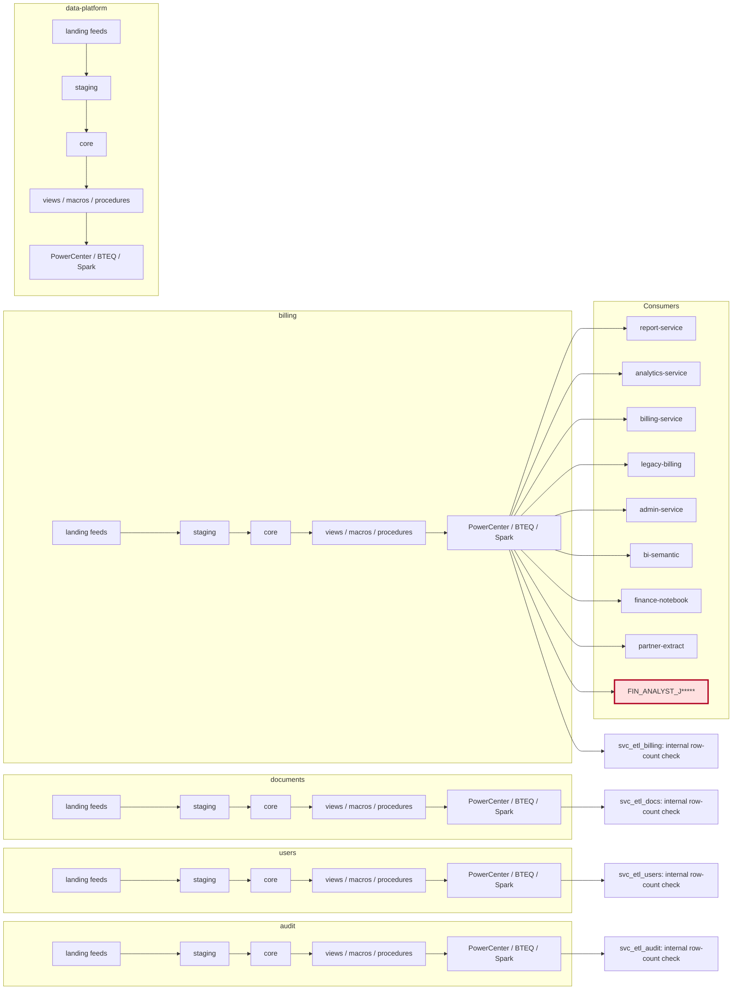

# Lineage

{'spark_ref': 'pr-2740', 'spark_commit': '40a2465c7eb30777a634abfa698d3a2e7ca17e47'}

Area-level overview; arrows represent feed/processing flow, not execution order. Detailed Spark reads/writes below are extracted from code literals.

## Spark code-level lineage

register/BatchSupport.register literals identify reads; save target literals identify writes. Tables are logical register names; runtime schema resolution is in common/runtime.py and BatchSupport.scala. External binary/lake inputs without register calls are shown as external.

```mermaid
flowchart LR
subgraph spark_billing["billing Spark transforms"]
j36e420fc9dda9a4a["billing_churn_score"]
db452a907ffba6100["SUBSCRIPTION"] --> j36e420fc9dda9a4a
j36e420fc9dda9a4a --> d11b3aa1d92a021af["/opt/lake/billing/billing_churn_score"]
j81f43bb8d0b21309["billing_gl_trial_balance"]
d1512dbc6f3d1087a["CREDIT_NOTE"] --> j81f43bb8d0b21309
db91eb75afc0bc5a0["GL_ACCOUNT"] --> j81f43bb8d0b21309
d63e65360c4b2620e["GL_JOURNAL_LINE"] --> j81f43bb8d0b21309
j81f43bb8d0b21309 --> dc987fff3d17b95ce["/opt/lake/billing/billing_gl_trial_balance"]
j81f43bb8d0b21309 --> d83660a92264a8087["SFX_BILLING.SPARK_GL_TRIAL_BALANCE"]
j31b693473f0cfb89["billing_invoice_summary_daily"]
df1aa0ab563c8440f["INVOICE_HDR"] --> j31b693473f0cfb89
dbcd0d5e364b4bb3c["INVOICE_LINE"] --> j31b693473f0cfb89
j31b693473f0cfb89 --> d1079c661068012b5["/opt/lake/billing/billing_invoice_summary_daily"]
j31b693473f0cfb89 --> dcc246d9135680dfb["SFX_BILLING.SPARK_INVOICE_SUMMARY"]
j240545304dd0cca3["billing_payment_aging"]
d23c3412ad60786bf["SFX_BILLING.INVOICE_HDR"] --> j240545304dd0cca3
d5a53a7738b9f0cb9["SFX_BILLING.PAYMENT"] --> j240545304dd0cca3
j240545304dd0cca3 --> dc3a848f26f768bd3["/opt/lake/billing/billing_payment_aging"]
j3e8b07384080134a["billing_revenue_by_plan"]
dbcd0d5e364b4bb3c["INVOICE_LINE"] --> j3e8b07384080134a
d45fccbb7559257c0["PLAN_CATALOG"] --> j3e8b07384080134a
j3e8b07384080134a --> d311229e1f3bbd535["/opt/lake/billing/billing_revenue_by_plan"]
jc5c27426ee958835["billing_usage_append_daily"]
de2262a896eaf2527["USAGE_DAILY"] --> jc5c27426ee958835
jc5c27426ee958835 --> d09e53eb76ce3a6ea["/opt/lake/billing/billing_usage_append_daily"]
jc5c27426ee958835 --> d717ea6a73ac3f41e["SFX_BILLING.SPARK_USAGE_DAILY"]
end
subgraph spark_documents["documents Spark transforms"]
jec470285f065ed9c["collab_session_sessionize"]
d984a23d77316cdea["COLLAB_SESSION"] --> jec470285f065ed9c
jec470285f065ed9c --> d34023ce67e04f9f5["/opt/lake/documents/collab_session_sessionize"]
j3656e055e27f9062["doc_share_graph_reach"]
dccc76b44df9f1667["DOC_SHARE"] --> j3656e055e27f9062
j3656e055e27f9062 --> db1133a8ab3fda51c["/opt/lake/documents/doc_share_graph_reach"]
jdf9f11d44d3ae705["doc_version_diff_stats"]
d0b2d6ec5a4a3caf0["DOC_VERSION"] --> jdf9f11d44d3ae705
jdf9f11d44d3ae705 --> d267f6db9cf34bbfb["/opt/lake/documents/doc_version_diff_stats"]
j449d7f13d2102104["docs_event_export_hourly"]
d667060ae7de0e37a["DOCUMENT"] --> j449d7f13d2102104
j449d7f13d2102104 --> d0e4d7394546dc2d1["/opt/lake/documents/docs_event_export_hourly"]
j804e1a6d4791df03["docs_folder_legacy_report"]
d667060ae7de0e37a["DOCUMENT"] --> j804e1a6d4791df03
dba25d0fcb2b365e2["FOLDER"] --> j804e1a6d4791df03
j804e1a6d4791df03 --> d0207c899af0376dc["/opt/lake/documents/docs_folder_legacy_report"]
je2b2fad1957273cb["docs_folder_tree_walk"]
dba25d0fcb2b365e2["FOLDER"] --> je2b2fad1957273cb
je2b2fad1957273cb --> d8cc4f1259d45ef3e["/opt/lake/documents/docs_folder_tree_walk"]
j226fcb6125cd01af["docs_search_log_parse"]
dcbdf1ad9408cd90b["SEARCH_INDEX_LOG"] --> j226fcb6125cd01af
j226fcb6125cd01af --> d6fdc951e3d05cd12["/opt/lake/documents/docs_search_log_parse"]
j1eb0f51fa396565a["docs_tag_normalize"]
dce486d40cca60f9a["DOC_TAG"] --> j1eb0f51fa396565a
j1eb0f51fa396565a --> d3445f9cd02fd58a5["/opt/lake/documents/docs_tag_normalize"]
j5378603daa2875d5["file_object_binary_extract"]
d48b8b03e7d38af03["FILE_OBJECT"] --> j5378603daa2875d5
j5378603daa2875d5 --> d85484a2b2462f3f5["/opt/lake/documents/file_object_binary_extract"]
j71b09ce48eacf50e["docs_share_activity"]
d667060ae7de0e37a["DOCUMENT"] --> j71b09ce48eacf50e
dccc76b44df9f1667["DOC_SHARE"] --> j71b09ce48eacf50e
j71b09ce48eacf50e --> d04cb09b75a226118["/opt/lake/documents/docs_share_activity"]
j2848accf505abb70["lake_compaction_documents"]
d0e4d7394546dc2d1["/opt/lake/documents/docs_event_export_hourly"] --> j2848accf505abb70
j2848accf505abb70 --> d0528d68ed98913f3["/opt/lake/documents/lake_compaction_documents"]
end
subgraph spark_users["users Spark transforms"]
j82e7b20b053c63d2["user_pref_json_flatten"]
defaf051b881cb0d3["USER_PREF"] --> j82e7b20b053c63d2
j82e7b20b053c63d2 --> d3c4fdb550b7d5ec4["/opt/lake/users/user_pref_json_flatten"]
j5202404d1a5ee738["users_active_daily"]
d48de3cf59504187c["USER_ACTIVITY_DAILY"] --> j5202404d1a5ee738
j5202404d1a5ee738 --> d765ad45e9a1f5162["/opt/lake/users/users_active_daily"]
j93b3d7ca84bbf546["users_login_useragent_parse"]
d7aab604de3815bc1["LOGIN_EVENT"] --> j93b3d7ca84bbf546
j93b3d7ca84bbf546 --> d9f1e70dfd98d89d7["/opt/lake/users/users_login_useragent_parse"]
j67c0593354ffde0a["users_team_rollup"]
d98050c9b1d9bf73a["APP_USER"] --> j67c0593354ffde0a
d16a0f11ea0338df5["TEAM"] --> j67c0593354ffde0a
d4a4440dde23fb8ab["TEAM_MEMBER"] --> j67c0593354ffde0a
j67c0593354ffde0a --> db937ab7a914178c4["/opt/lake/users/users_team_rollup"]
j67c0593354ffde0a --> d8e150801320b7a3c["SFX_USERS.SPARK_TEAM_ROLLUP"]
je74cf4a953626a7e["team_graph_components"]
d4a4440dde23fb8ab["TEAM_MEMBER"] --> je74cf4a953626a7e
je74cf4a953626a7e --> d706e1d3f3fec48fd["/opt/lake/users/team_graph_components"]
j3b611fa411d110e0["users_risk_score"]
d48de3cf59504187c["USER_ACTIVITY_DAILY"] --> j3b611fa411d110e0
j3b611fa411d110e0 --> d0965979a7aa986e4["/opt/lake/users/users_risk_score"]
j3b611fa411d110e0 --> d8a7df73f3c6d3cbf["SFX_USERS.SPARK_RISK_SCORE"]
end
subgraph spark_audit["audit Spark transforms"]
jd505e2c0c31cf608["audit_archive_resort"]
da2911c5a0e911100["AUDIT_EVENT_ARCHIVE"] --> jd505e2c0c31cf608
jd505e2c0c31cf608 --> dfd4ea13eab731a5a["/opt/lake/audit/audit_archive_resort"]
j21023332aa8b55ce["lake_compaction_audit"]
d4885ed15147af000["/opt/lake/audit/audit_daily_summary"] --> j21023332aa8b55ce
j21023332aa8b55ce --> de75ac5497166aed4["/opt/lake/audit/lake_compaction_audit"]
j348248e32efac0da["security_alert_anomaly"]
d9619d7898b610be2["SECURITY_ALERT"] --> j348248e32efac0da
j348248e32efac0da --> d2c1021757ab4ed4c["/opt/lake/audit/security_alert_anomaly"]
j348248e32efac0da --> dbc63e08276a05810["SFX_AUDIT.SPARK_ALERT_ANOMALY"]
je2e681f4b1b8c75f["audit_daily_summary"]
d126a5a54ed7b3d5e["AUDIT_EVENT"] --> je2e681f4b1b8c75f
je2e681f4b1b8c75f --> d4885ed15147af000["/opt/lake/audit/audit_daily_summary"]
je2e681f4b1b8c75f --> d6d6aa2c01912bcdb["SFX_AUDIT.SPARK_AUDIT_SUMMARY"]
jf8710c1a5ac6d3c9["compliance_flag_rules"]
d1da8d20bd88089c5["COMPLIANCE_FLAG"] --> jf8710c1a5ac6d3c9
jf8710c1a5ac6d3c9 --> d96fcbd952041d9c7["/opt/lake/audit/compliance_flag_rules"]
jf8710c1a5ac6d3c9 --> d42ff47b8040544b2["SFX_AUDIT.SPARK_COMPLIANCE_REVIEW"]
end
subgraph spark_data_platform["data-platform Spark transforms"]
j3239a0ca48ca7071["audit_actor_activity_join"]
d31c817618100f7da["AUDIT_EVENT"] --> j3239a0ca48ca7071
d33903dbc34c61272["LOGIN_EVENT"] --> j3239a0ca48ca7071
d4d7491c0552016c7["USER_ACTIVITY_DAILY"] --> j3239a0ca48ca7071
j3239a0ca48ca7071 --> d7dabe6babc69a713["/opt/lake/audit/audit_actor_activity_join"]
j2b7a6d8d0e305a41["docs_storage_by_owner"]
d94b4c98cf6d95ece["APP_USER"] --> j2b7a6d8d0e305a41
d0a52133d2b719945["DOCUMENT"] --> j2b7a6d8d0e305a41
d06706a9d55a9bec3["FILE_OBJECT"] --> j2b7a6d8d0e305a41
j2b7a6d8d0e305a41 --> d6a67b72f45ee214c["/opt/lake/documents/docs_storage_by_owner"]
end
```

## Spark code-level references

| Job | Reads | Writes | Source |
|---|---|---|---|
| audit_actor_activity_join | AUDIT_EVENT, LOGIN_EVENT, USER_ACTIVITY_DAILY | /opt/lake/audit/audit_actor_activity_join | etl/spark/jobs/py/audit_actor_activity_join.py |
| audit_archive_resort | AUDIT_EVENT_ARCHIVE | /opt/lake/audit/audit_archive_resort | etl/spark/jobs/py/audit_archive_resort.py |
| billing_churn_score | SUBSCRIPTION | /opt/lake/billing/billing_churn_score | etl/spark/jobs/py/billing_churn_score.py |
| billing_gl_trial_balance | CREDIT_NOTE, GL_ACCOUNT, GL_JOURNAL_LINE | /opt/lake/billing/billing_gl_trial_balance, SFX_BILLING.SPARK_GL_TRIAL_BALANCE | etl/spark/jobs/py/billing_gl_trial_balance.py |
| billing_invoice_summary_daily | INVOICE_HDR, INVOICE_LINE | /opt/lake/billing/billing_invoice_summary_daily, SFX_BILLING.SPARK_INVOICE_SUMMARY | etl/spark/jobs/py/billing_invoice_summary_daily.py |
| billing_payment_aging | SFX_BILLING.INVOICE_HDR, SFX_BILLING.PAYMENT | /opt/lake/billing/billing_payment_aging | etl/spark/jobs/py/billing_payment_aging.py |
| billing_revenue_by_plan | INVOICE_LINE, PLAN_CATALOG | /opt/lake/billing/billing_revenue_by_plan | etl/spark/jobs/py/billing_revenue_by_plan.py |
| billing_usage_append_daily | USAGE_DAILY | /opt/lake/billing/billing_usage_append_daily, SFX_BILLING.SPARK_USAGE_DAILY | etl/spark/jobs/py/billing_usage_append_daily.py |
| collab_session_sessionize | COLLAB_SESSION | /opt/lake/documents/collab_session_sessionize | etl/spark/jobs/py/collab_session_sessionize.py |
| doc_share_graph_reach | DOC_SHARE | /opt/lake/documents/doc_share_graph_reach | etl/spark/jobs/py/doc_share_graph_reach.py |
| doc_version_diff_stats | DOC_VERSION | /opt/lake/documents/doc_version_diff_stats | etl/spark/jobs/py/doc_version_diff_stats.py |
| docs_event_export_hourly | DOCUMENT | /opt/lake/documents/docs_event_export_hourly | etl/spark/jobs/py/docs_event_export_hourly.py |
| docs_folder_legacy_report | DOCUMENT, FOLDER | /opt/lake/documents/docs_folder_legacy_report | etl/spark/jobs/py/docs_folder_legacy_report.py |
| docs_folder_tree_walk | FOLDER | /opt/lake/documents/docs_folder_tree_walk | etl/spark/jobs/py/docs_folder_tree_walk.py |
| docs_search_log_parse | SEARCH_INDEX_LOG | /opt/lake/documents/docs_search_log_parse | etl/spark/jobs/py/docs_search_log_parse.py |
| docs_storage_by_owner | APP_USER, DOCUMENT, FILE_OBJECT | /opt/lake/documents/docs_storage_by_owner | etl/spark/jobs/py/docs_storage_by_owner.py |
| docs_tag_normalize | DOC_TAG | /opt/lake/documents/docs_tag_normalize | etl/spark/jobs/py/docs_tag_normalize.py |
| file_object_binary_extract | FILE_OBJECT | /opt/lake/documents/file_object_binary_extract | etl/spark/jobs/py/file_object_binary_extract.py |
| lake_compaction_audit | /opt/lake/audit/audit_daily_summary | /opt/lake/audit/lake_compaction_audit | etl/spark/jobs/py/lake_compaction_audit.py |
| security_alert_anomaly | SECURITY_ALERT | /opt/lake/audit/security_alert_anomaly, SFX_AUDIT.SPARK_ALERT_ANOMALY | etl/spark/jobs/py/security_alert_anomaly.py |
| user_pref_json_flatten | USER_PREF | /opt/lake/users/user_pref_json_flatten | etl/spark/jobs/py/user_pref_json_flatten.py |
| users_active_daily | USER_ACTIVITY_DAILY | /opt/lake/users/users_active_daily | etl/spark/jobs/py/users_active_daily.py |
| users_login_useragent_parse | LOGIN_EVENT | /opt/lake/users/users_login_useragent_parse | etl/spark/jobs/py/users_login_useragent_parse.py |
| users_team_rollup | APP_USER, TEAM, TEAM_MEMBER | /opt/lake/users/users_team_rollup, SFX_USERS.SPARK_TEAM_ROLLUP | etl/spark/jobs/py/users_team_rollup.py |
| audit_daily_summary | AUDIT_EVENT | /opt/lake/audit/audit_daily_summary, SFX_AUDIT.SPARK_AUDIT_SUMMARY | etl/spark/scala/src/main/scala/sfx/AuditDailySummary.scala |
| compliance_flag_rules | COMPLIANCE_FLAG | /opt/lake/audit/compliance_flag_rules, SFX_AUDIT.SPARK_COMPLIANCE_REVIEW | etl/spark/scala/src/main/scala/sfx/ComplianceFlagRules.scala |
| docs_share_activity | DOCUMENT, DOC_SHARE | /opt/lake/documents/docs_share_activity | etl/spark/scala/src/main/scala/sfx/DocsShareActivity.scala |
| lake_compaction_documents | /opt/lake/documents/docs_event_export_hourly | /opt/lake/documents/lake_compaction_documents | etl/spark/scala/src/main/scala/sfx/LakeCompactionDocuments.scala |
| team_graph_components | TEAM_MEMBER | /opt/lake/users/team_graph_components | etl/spark/scala/src/main/scala/sfx/TeamGraphComponents.scala |
| users_risk_score | USER_ACTIVITY_DAILY | /opt/lake/users/users_risk_score, SFX_USERS.SPARK_RISK_SCORE | etl/spark/scala/src/main/scala/sfx/UsersRiskScore.scala |
