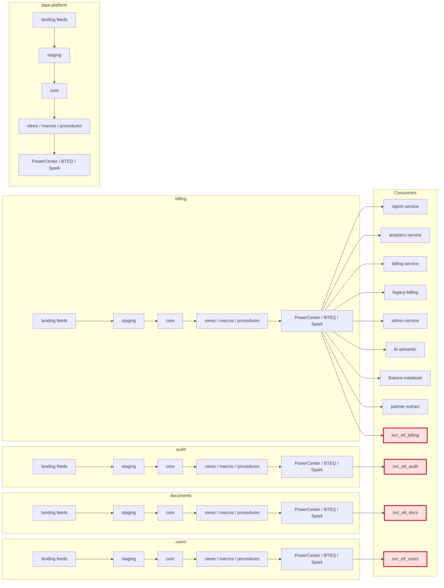
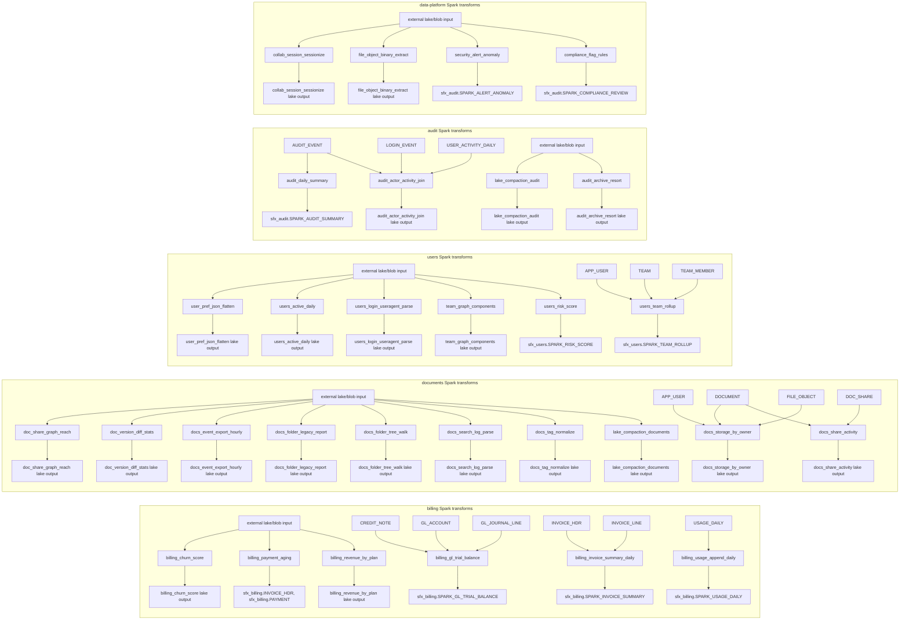

# Lineage

{'spark_ref': 'pr-2740', 'spark_commit': '40a2465c7eb30777a634abfa698d3a2e7ca17e47'}

Area-level overview; arrows represent feed/processing flow, not execution order. Detailed Spark reads/writes below are extracted from code literals.

## Spark code-level lineage

register/BatchSupport.register literals identify reads; save target literals identify writes. Tables are logical register names; runtime schema resolution is in common/runtime.py and BatchSupport.scala. External binary/lake inputs without register calls are shown as external.

## Spark code-level references

| Job | Read/write evidence (code literals; physical paths also retained) | Source |
|---|---|---|
| audit_actor_activity_join | AUDIT_EVENT, LOGIN_EVENT, USER_ACTIVITY_DAILY | etl/spark/jobs/py/audit_actor_activity_join.py |
| audit_archive_resort | AUDIT_EVENT_ARCHIVE, AUDIT_EVENT_ARCHIVE_ID, EVENT_AT, EVENT_TYPE | etl/spark/jobs/py/audit_archive_resort.py |
| billing_churn_score | CHURN_SCORE, CUSTOMER_ID, STATUS, SUBSCRIPTION | etl/spark/jobs/py/billing_churn_score.py |
| billing_gl_trial_balance | CREDIT_NOTE, GL_ACCOUNT, GL_JOURNAL_LINE, sfx_billing.SPARK_GL_TRIAL_BALANCE | etl/spark/jobs/py/billing_gl_trial_balance.py |
| billing_invoice_summary_daily | INVOICE_HDR, INVOICE_LINE, sfx_billing.SPARK_INVOICE_SUMMARY | etl/spark/jobs/py/billing_invoice_summary_daily.py |
| billing_payment_aging | INVOICE_HDR, PAYMENT, sfx_billing.INVOICE_HDR, sfx_billing.PAYMENT | etl/spark/jobs/py/billing_payment_aging.py |
| billing_revenue_by_plan | INVOICE_LINE, PLAN_CATALOG | etl/spark/jobs/py/billing_revenue_by_plan.py |
| billing_usage_append_daily | USAGE_DAILY, sfx_billing.SPARK_USAGE_DAILY | etl/spark/jobs/py/billing_usage_append_daily.py |
| collab_session_sessionize | COLLAB_SESSION | etl/spark/jobs/py/collab_session_sessionize.py |
| doc_share_graph_reach | DOC_SHARE | etl/spark/jobs/py/doc_share_graph_reach.py |
| doc_version_diff_stats | BODY, DOCUMENT_ID, DOC_VERSION, PREVIOUS_BODY, SIMILARITY, VERSION_NUMBER | etl/spark/jobs/py/doc_version_diff_stats.py |
| docs_event_export_hourly | DOCUMENT, DOCUMENT_ID, EXPORT_BUCKET | etl/spark/jobs/py/docs_event_export_hourly.py |
| docs_folder_legacy_report | DOCUMENT, FOLDER | etl/spark/jobs/py/docs_folder_legacy_report.py |
| docs_folder_tree_walk | FOLDER | etl/spark/jobs/py/docs_folder_tree_walk.py |
| docs_search_log_parse | PARSED_ACTION, RAW_LINE, SEARCH_INDEX_LOG | etl/spark/jobs/py/docs_search_log_parse.py |
| docs_storage_by_owner | APP_USER, DOCUMENT, FILE_OBJECT | etl/spark/jobs/py/docs_storage_by_owner.py |
| docs_tag_normalize | DOC_TAG, NORMALIZED_TAG, TAG | etl/spark/jobs/py/docs_tag_normalize.py |
| file_object_binary_extract | ERROR, EXTRACT, FILE_OBJECT, MEDIA_TYPE, PAGE_COUNT, SHA256, STORAGE_KEY, TEXT | etl/spark/jobs/py/file_object_binary_extract.py |
| lake_compaction_audit |  | etl/spark/jobs/py/lake_compaction_audit.py |
| security_alert_anomaly | SECURITY_ALERT, sfx_audit.SPARK_ALERT_ANOMALY | etl/spark/jobs/py/security_alert_anomaly.py |
| user_pref_json_flatten | PREF_JSON, USER_PREF | etl/spark/jobs/py/user_pref_json_flatten.py |
| users_active_daily | USER_ACTIVITY_DAILY | etl/spark/jobs/py/users_active_daily.py |
| users_login_useragent_parse | BROWSER, LOGIN_EVENT, USER_AGENT | etl/spark/jobs/py/users_login_useragent_parse.py |
| users_team_rollup | APP_USER, TEAM, TEAM_MEMBER, sfx_users.SPARK_TEAM_ROLLUP | etl/spark/jobs/py/users_team_rollup.py |
| audit_daily_summary | AUDIT_EVENT, sfx_audit.SPARK_AUDIT_SUMMARY | etl/spark/scala/src/main/scala/sfx/AuditDailySummary.scala |
| compliance_flag_rules | COMPLIANCE_FLAG, COMPLIANCE_FLAG_ID, DISPOSITION, DOCUMENT_ID, FLAG_ID, SEVERITY, STATUS, sfx_audit.SPARK_COMPLIANCE_REVIEW | etl/spark/scala/src/main/scala/sfx/ComplianceFlagRules.scala |
| docs_share_activity | DOCUMENT, DOC_SHARE | etl/spark/scala/src/main/scala/sfx/DocsShareActivity.scala |
| lake_compaction_documents |  | etl/spark/scala/src/main/scala/sfx/LakeCompactionDocuments.scala |
| team_graph_components | COMPONENT_ID, TEAM_ID, TEAM_MEMBER, USER_ID | etl/spark/scala/src/main/scala/sfx/TeamGraphComponents.scala |
| users_risk_score | ACTION_COUNT, LOGIN_COUNT, RISK_SCORE, USER_ACTIVITY_DAILY, sfx_users.SPARK_RISK_SCORE | etl/spark/scala/src/main/scala/sfx/UsersRiskScore.scala |
